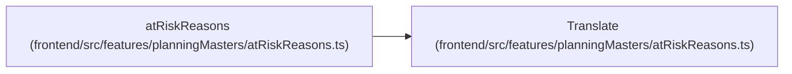

> **Retired source member:** This declaration is no longer in the selected source inventory. The content below is retained history, not current source evidence or an authored lifecycle decision.

# Translate

**Location:** `frontend/src/features/planningMasters/atRiskReasons.ts:4`
**Kind:** Type alias
**Bases:** —
**Module:** [atRiskReasons](../modules/atRiskReasons.md)
**Target:**

```typescript
(key: string) => string
```

## Description

_Auto-generated from `Translate` in `frontend/src/features/planningMasters/atRiskReasons.ts`._

## Attributes

*See the alias definition for its member types.*

## Methods

*See the alias definition for callable and member types.*

## Relationships

<!-- Auto-generated relationship summary. Do not edit by hand. -->


### Summary

| Module | Methods | Attributes |
|---|---:|---|
| [atRiskReasons](../modules/atRiskReasons.md) | 0 | — |

### References

| Reference | Kind | Source | Call sites |
|---|---|---|---:|
| `atRiskReasons` | type_reference | [atRiskReasons](../modules/atRiskReasons.md) | — |
