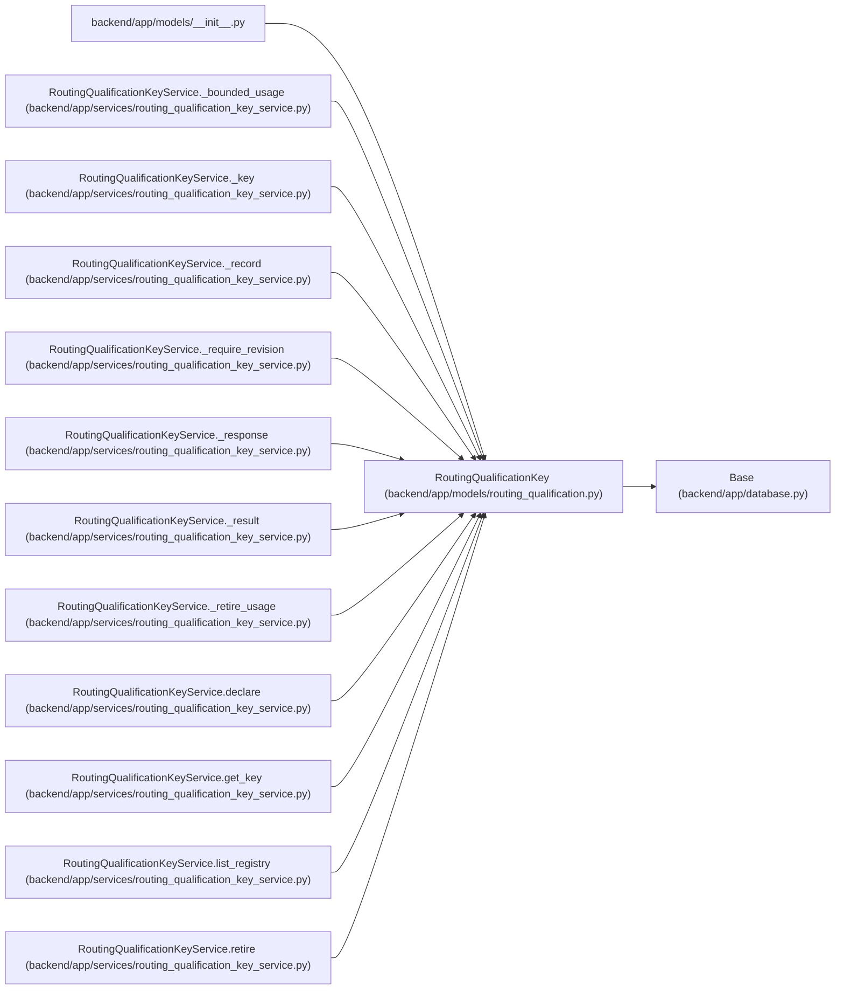

# RoutingQualificationKey

**Location:** `backend/app/models/routing_qualification.py:16`
**Kind:** Class
**Bases:** `Base`
**Module:** [models_routing_qualification](../modules/models_routing_qualification.md)

## Description

One deployment-declared key that catalog entries and task requirements may name.

The key name never changes. Retiring keeps the row and its history, so a
later declaration under the same name continues the revision sequence.

## Attributes

| Name | Type | Default | Description |
|------|------|---------|-------------|
| `id` | `Mapped[int]` | `mapped_column(Integer, primary_key=True, autoincrement=True)` | — |
| `key` | `Mapped[str]` | `mapped_column(String(120), nullable=False)` | — |
| `label` | `Mapped[str]` | `mapped_column(String(255), nullable=False)` | — |
| `description` | `Mapped[Optional[str]]` | `mapped_column(Text)` | — |
| `state` | `Mapped[str]` | `mapped_column(String(20), default='active', nullable=False)` | — |
| `revision` | `Mapped[int]` | `mapped_column(Integer, default=1, nullable=False)` | — |
| `created_at` | `Mapped[datetime]` | `mapped_column(UTCDateTime(), default=utc_now, nullable=False)` | — |
| `updated_at` | `Mapped[datetime]` | `mapped_column(UTCDateTime(), default=utc_now, onupdate=utc_now, nullable=False)` | — |
| `retired_at` | `Mapped[Optional[datetime]]` | `mapped_column(UTCDateTime(), nullable=True)` | — |
| `revisions` | `Mapped[list['RoutingQualificationKeyRevision']]` | `relationship('RoutingQualificationKeyRevision', back_populates='qualification_key', order_by='RoutingQualificationKeyRevision.revision')` | — |

## Methods

*No declared methods.*

## Relationships

<!-- Auto-generated relationship summary. Do not edit by hand. -->

### Summary

| Module | Methods | Attributes |
|---|---:|---|
| [models_routing_qualification](../modules/models_routing_qualification.md) | 0 | `created_at`, `description`, `id`, `key`, `label`, `retired_at`, `revision`, `revisions`, `state`, `updated_at` |

### Structure

| Kind | Entity | Module |
|---|---|---|
| Base | `Base` | [app_database](../modules/app_database.md) |

### References

| Reference | Kind | Source | Call sites |
|---|---|---|---:|
| `__init__` | import | [models___init__](../modules/models___init__.md) | — |
| `RoutingQualificationKeyService._bounded_usage` | type_reference | [routing_qualification_key_service](../modules/routing_qualification_key_service.md) | — |
| `RoutingQualificationKeyService._key` | type_reference | [routing_qualification_key_service](../modules/routing_qualification_key_service.md) | — |
| `RoutingQualificationKeyService._record` | type_reference | [routing_qualification_key_service](../modules/routing_qualification_key_service.md) | — |
| `RoutingQualificationKeyService._require_revision` | type_reference | [routing_qualification_key_service](../modules/routing_qualification_key_service.md) | — |
| `RoutingQualificationKeyService._response` | type_reference | [routing_qualification_key_service](../modules/routing_qualification_key_service.md) | — |
| `RoutingQualificationKeyService._result` | type_reference | [routing_qualification_key_service](../modules/routing_qualification_key_service.md) | — |
| `RoutingQualificationKeyService._retire_usage` | type_reference | [routing_qualification_key_service](../modules/routing_qualification_key_service.md) | — |
| `RoutingQualificationKeyService.declare` | type_reference | [routing_qualification_key_service](../modules/routing_qualification_key_service.md) | — |
| `RoutingQualificationKeyService.get_key` | type_reference | [routing_qualification_key_service](../modules/routing_qualification_key_service.md) | — |
| `RoutingQualificationKeyService.list_registry` | type_reference | [routing_qualification_key_service](../modules/routing_qualification_key_service.md) | — |
| `RoutingQualificationKeyService.retire` | type_reference | [routing_qualification_key_service](../modules/routing_qualification_key_service.md) | — |

> References: showing 12 of 19 logical references; 7 omitted by the 12-row generated summary limit.
