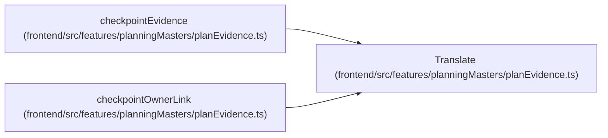

# Translate

**Location:** `frontend/src/features/planningMasters/planEvidence.ts:10`
**Kind:** Type alias
**Bases:** —
**Module:** [planEvidence](../modules/planEvidence.md)
**Target:**

```typescript
(key: string, options?: Record<string, unknown>) => string
```

## Description

_Auto-generated from `Translate` in `frontend/src/features/planningMasters/planEvidence.ts`._

## Attributes

*See the alias definition for its member types.*

## Methods

*See the alias definition for callable and member types.*

## Relationships

<!-- Auto-generated relationship summary. Do not edit by hand. -->


### Summary

| Module | Methods | Attributes |
|---|---:|---|
| [planEvidence](../modules/planEvidence.md) | 0 | — |

### References

| Reference | Kind | Source | Call sites |
|---|---|---|---:|
| `checkpointEvidence` | type_reference | [planEvidence](../modules/planEvidence.md) | — |
| `checkpointOwnerLink` | type_reference | [planEvidence](../modules/planEvidence.md) | — |
