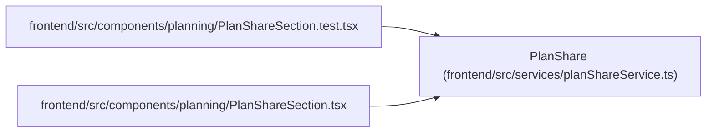

# PlanShare

**Location:** `frontend/src/services/planShareService.ts:41`
**Kind:** Interface
**Bases:** —
**Module:** [planShareService](../modules/planShareService.md)

## Description

_Auto-generated from `PlanShare` in `frontend/src/services/planShareService.ts`._

## Attributes

| Name | Type | Required | Default | Description |
|------|------|----------|---------|-------------|
| `id` | `number` | Yes | — | — |
| `public_id` | `string` | Yes | — | — |
| `iteration_id` | `number` | Yes | — | — |
| `iteration_name` | `string` | Yes | — | — |
| `created_by_display` | `string` | Yes | — | — |
| `snapshot_data` | `PlanShareSnapshot` | Yes | — | — |
| `created_at` | `string` | Yes | — | — |
| `revoked_at` | `string \| null` | No | — | — |

## Methods

*No declared methods.*

## Relationships

<!-- Auto-generated relationship summary. Do not edit by hand. -->

### Summary

| Module | Methods | Attributes |
|---|---:|---|
| [planShareService](../modules/planShareService.md) | 0 | `created_at`, `created_by_display`, `id`, `iteration_id`, `iteration_name`, `public_id`, `revoked_at`, `snapshot_data` |

### References

| Reference | Kind | Source | Call sites |
|---|---|---|---:|
| `PlanShareSection.test` | import | [PlanShareSection.test](../modules/PlanShareSection.test.md) | — |
| `PlanShareSection` | import | [PlanShareSection](../modules/PlanShareSection.md) | — |
