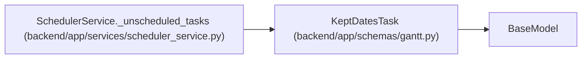

# KeptDatesTask

**Location:** `backend/app/schemas/gantt.py:123`
**Kind:** Pydantic model
**Bases:** `BaseModel`
**Module:** [schemas_gantt](../modules/schemas_gantt.md)

## Description

A planned task the scheduler could not place; it keeps the dates it already had.

## Attributes

| Name | Type | Wire name | Required | Nullable | Default | Constraints | Examples | Description |
|------|------|-----------|----------|----------|---------|-------------|-------------|----------|
| `task_id` | `int` | `task_id` | Yes | No | — | — | — | — |
| `task_title` | `str` | `task_title` | Yes | No | — | — | — | — |
| `reason` | `UnscheduledReason` | `reason` | Yes | No | — | — | — | — |
| `message` | `str` | `message` | Yes | No | — | — | — | — |
| `start_date` | `date` | `start_date` | Yes | No | — | — | — | — |
| `end_date` | `date` | `end_date` | Yes | No | — | — | — | — |
| `date_rule` | `DateRule \| None` | `date_rule` | No | Yes | `None` | — | — | — |
| `also` | `list[UnscheduledReason]` | `also` | No | No | `[]` | — | — | — |
| `waiting_on` | `list[WaitingOnTask]` | `waiting_on` | No | No | factory: `list` | — | — | — |

## Methods

*No declared methods.*

## Relationships

<!-- Auto-generated relationship summary. Do not edit by hand. -->

### Summary

| Module | Methods | Attributes |
|---|---:|---|
| [schemas_gantt](../modules/schemas_gantt.md) | 0 | `also`, `date_rule`, `end_date`, `message`, `reason`, `start_date`, `task_id`, `task_title`, `waiting_on` |

### Structure

| Kind | Entity | Module |
|---|---|---|
| Base | `BaseModel` | — |

### References

| Reference | Kind | Source | Call sites |
|---|---|---|---:|
| `SchedulerService._unscheduled_tasks` | call | [scheduler_service](../modules/scheduler_service.md) | 1 |
| `SchedulerService._unscheduled_tasks` | type_reference | [scheduler_service](../modules/scheduler_service.md) | — |
