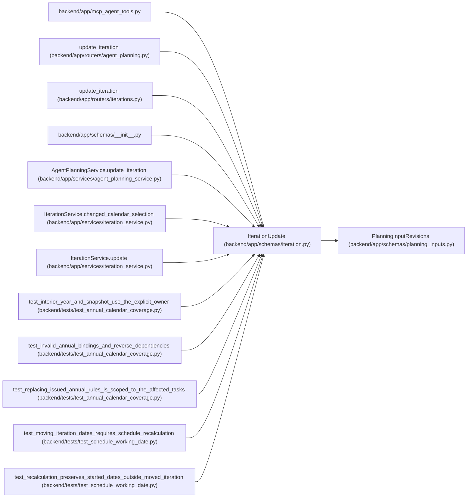

# IterationUpdate

**Location:** `backend/app/schemas/iteration.py:23`
**Kind:** Pydantic model
**Bases:** `PlanningInputRevisions`
**Module:** [schemas_iteration](../modules/schemas_iteration.md)

## Description

Schema for updating an iteration.

## Attributes

| Name | Type | Wire name | Required | Nullable | Default | Constraints | Examples | Description |
|------|------|-----------|----------|----------|---------|-------------|-------------|----------|
| `name` | `Optional[str]` | `name` | No | Yes | `None` | max_length=255; min_length=1 | — | — |
| `calendar_id` | `Optional[int]` | `calendar_id` | No | Yes | `None` | — | — | — |
| `additional_calendar_ids` | `list[int] \| None` | `additional_calendar_ids` | No | Yes | `None` | max_length=100 | — | — |
| `project_id` | `Optional[int]` | `project_id` | No | Yes | `None` | — | — | — |
| `start_date` | `Optional[date]` | `start_date` | No | Yes | `None` | — | — | — |
| `end_date` | `Optional[date]` | `end_date` | No | Yes | `None` | — | — | — |
| `manager_email` | `Optional[str]` | `manager_email` | No | Yes | `None` | max_length=255 | — | — |

## Methods

*No declared methods.*

## Relationships

<!-- Auto-generated relationship summary. Do not edit by hand. -->

### Summary

| Module | Methods | Attributes |
|---|---:|---|
| [schemas_iteration](../modules/schemas_iteration.md) | 0 | `additional_calendar_ids`, `calendar_id`, `end_date`, `manager_email`, `name`, `project_id`, `start_date` |

### Structure

| Kind | Entity | Module |
|---|---|---|
| Base | `PlanningInputRevisions` | [planning_inputs](../modules/planning_inputs.md) |

### References

| Reference | Kind | Source | Call sites |
|---|---|---|---:|
| `mcp_agent_tools` | import | [mcp_agent_tools](../modules/mcp_agent_tools.md) | — |
| `update_iteration` | type_reference | [routers_agent_planning](../modules/routers_agent_planning.md) | — |
| `update_iteration` | type_reference | [iterations](../modules/iterations.md) | — |
| `__init__` | import | [schemas___init__](../modules/schemas___init__.md) | — |
| `AgentPlanningService.update_iteration` | type_reference | [agent_planning_service](../modules/agent_planning_service.md) | — |
| `IterationService.changed_calendar_selection` | type_reference | [iteration_service](../modules/iteration_service.md) | — |
| `IterationService.update` | type_reference | [iteration_service](../modules/iteration_service.md) | — |
| `test_interior_year_and_snapshot_use_the_explicit_owner` | call | [test_annual_calendar_coverage](../modules/test_annual_calendar_coverage.md) | 1 |
| `test_invalid_annual_bindings_and_reverse_dependencies` | call | [test_annual_calendar_coverage](../modules/test_annual_calendar_coverage.md) | 1 |
| `test_replacing_issued_annual_rules_is_scoped_to_the_affected_tasks` | call | [test_annual_calendar_coverage](../modules/test_annual_calendar_coverage.md) | 1 |
| `test_moving_iteration_dates_requires_schedule_recalculation` | call | [test_schedule_working_date](../modules/test_schedule_working_date.md) | 1 |
| `test_recalculation_preserves_started_dates_outside_moved_iteration` | call | [test_schedule_working_date](../modules/test_schedule_working_date.md) | 1 |

> References: showing 12 of 13 logical references; 1 omitted by the 12-row generated summary limit.
