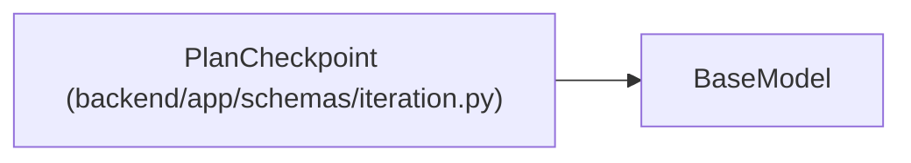

# PlanCheckpoint

**Location:** `backend/app/schemas/iteration.py:116`
**Kind:** Pydantic model
**Bases:** `BaseModel`
**Module:** [schemas_iteration](../modules/schemas_iteration.md)

## Description

One of the six plan checkpoints, in the order people and the PM work them.

## Attributes

| Name | Type | Wire name | Required | Nullable | Default | Constraints | Examples | Description |
|------|------|-----------|----------|----------|---------|-------------|-------------|----------|
| `id` | `Literal['iteration', 'team', 'work', 'blockers', 'schedule', 'review']` | `id` | Yes | No | — | — | — | — |
| `state` | `Literal['done', 'warn', 'todo', 'blocked']` | `state` | Yes | No | — | — | — | — |
| `reason_codes` | `list[str]` | `reason_codes` | No | No | factory: `list` | — | — | — |
| `counts` | `dict[str, int]` | `counts` | No | No | factory: `dict` | — | — | — |

## Methods

*No declared methods.*

## Relationships

<!-- Auto-generated relationship summary. Do not edit by hand. -->

### Summary

| Module | Methods | Attributes |
|---|---:|---|
| [schemas_iteration](../modules/schemas_iteration.md) | 0 | `counts`, `id`, `reason_codes`, `state` |

### Structure

| Kind | Entity | Module |
|---|---|---|
| Base | `BaseModel` | — |
