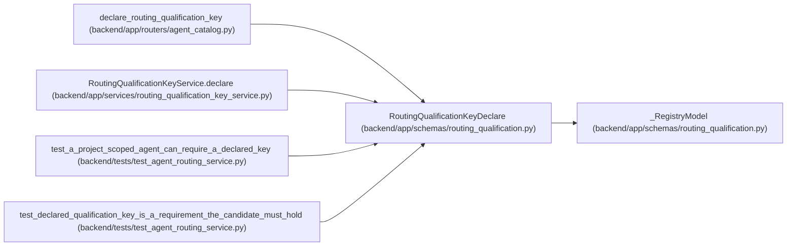

# RoutingQualificationKeyDeclare

**Location:** `backend/app/schemas/routing_qualification.py:40`
**Kind:** Pydantic model
**Bases:** `_RegistryModel`
**Module:** [schemas_routing_qualification](../modules/schemas_routing_qualification.md)

## Description

Declare a new key, or bring back a retired one under the same name.

## Validators

| Method | Scope | Fields | Mode | Options |
|--------|-------|--------|------|---------|
| `normalize_key` | field | key | before | — |
| `strip_label` | field | label | after | — |
| `strip_description` | field | description | after | — |

## Attributes

| Name | Type | Wire name | Required | Nullable | Default | Constraints | Examples | Description |
|------|------|-----------|----------|----------|---------|-------------|-------------|----------|
| `key` | `RoutingKey` | `key` | Yes | No | — | — | — | — |
| `label` | `str` | `label` | Yes | No | — | min_length=1; max_length=unknown (MAX_QUALIFICATION_KEY_LABEL) | — | — |
| `description` | `str \| None` | `description` | No | Yes | `None` | max_length=unknown (MAX_QUALIFICATION_KEY_DESCRIPTION) | — | — |

## Methods

| Method | Signature | Decorators | Description |
|--------|-----------|------------|-------------|
| `normalize_key` | `(value: object) -> object` | `@field_validator('key', mode='before')`, `@classmethod` | — |
| `strip_label` | `(value: str) -> str` | `@field_validator('label')`, `@classmethod` | — |
| `strip_description` | `(value: str \| None) -> str \| None` | `@field_validator('description')`, `@classmethod` | — |

## Relationships

<!-- Auto-generated relationship summary. Do not edit by hand. -->

### Summary

| Module | Methods | Attributes |
|---|---:|---|
| [schemas_routing_qualification](../modules/schemas_routing_qualification.md) | 3 | `description`, `key`, `label` |

### Structure

| Kind | Entity | Module |
|---|---|---|
| Base | `_RegistryModel` | [schemas_routing_qualification](../modules/schemas_routing_qualification.md) |

### References

| Reference | Kind | Source | Call sites |
|---|---|---|---:|
| `declare_routing_qualification_key` | type_reference | [agent_catalog](../modules/agent_catalog.md) | — |
| `RoutingQualificationKeyService.declare` | type_reference | [routing_qualification_key_service](../modules/routing_qualification_key_service.md) | — |
| `test_a_project_scoped_agent_can_require_a_declared_key` | call | [test_agent_routing_service](../modules/test_agent_routing_service.md) | 1 |
| `test_declared_qualification_key_is_a_requirement_the_candidate_must_hold` | call | [test_agent_routing_service](../modules/test_agent_routing_service.md) | 1 |
