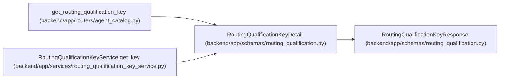

# RoutingQualificationKeyDetail

**Location:** `backend/app/schemas/routing_qualification.py:167`
**Kind:** Pydantic model
**Bases:** `RoutingQualificationKeyResponse`
**Module:** [schemas_routing_qualification](../modules/schemas_routing_qualification.md)

## Description

One key with its revision history and current usage.

## Attributes

| Name | Type | Wire name | Required | Nullable | Default | Constraints | Examples | Description |
|------|------|-----------|----------|----------|---------|-------------|-------------|----------|
| `revisions` | `list[RoutingQualificationKeyRevisionResponse]` | `revisions` | No | No | factory: `list` | — | — | — |
| `usage` | `RoutingQualificationKeyUsage` | `usage` | Yes | No | — | — | — | — |

## Methods

*No declared methods.*

## Relationships

<!-- Auto-generated relationship summary. Do not edit by hand. -->

### Summary

| Module | Methods | Attributes |
|---|---:|---|
| [schemas_routing_qualification](../modules/schemas_routing_qualification.md) | 0 | `revisions`, `usage` |

### Structure

| Kind | Entity | Module |
|---|---|---|
| Base | `RoutingQualificationKeyResponse` | [schemas_routing_qualification](../modules/schemas_routing_qualification.md) |

### References

| Reference | Kind | Source | Call sites |
|---|---|---|---:|
| `get_routing_qualification_key` | type_reference | [agent_catalog](../modules/agent_catalog.md) | — |
| `RoutingQualificationKeyService.get_key` | call | [routing_qualification_key_service](../modules/routing_qualification_key_service.md) | 1 |
| `RoutingQualificationKeyService.get_key` | type_reference | [routing_qualification_key_service](../modules/routing_qualification_key_service.md) | — |
