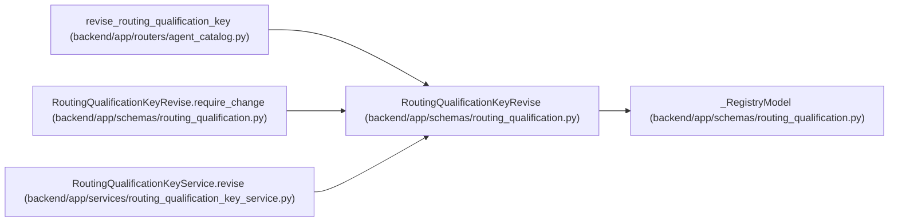

# RoutingQualificationKeyRevise

**Location:** `backend/app/schemas/routing_qualification.py:63`
**Kind:** Pydantic model
**Bases:** `_RegistryModel`
**Module:** [schemas_routing_qualification](../modules/schemas_routing_qualification.md)

## Description

Change an active key's label or description; the key itself never changes.

## Validators

| Method | Scope | Fields | Mode | Options |
|--------|-------|--------|------|---------|
| `strip_label` | field | label | after | — |
| `strip_description` | field | description | after | — |
| `require_change` | model | — | after | — |

## Attributes

| Name | Type | Wire name | Required | Nullable | Default | Constraints | Examples | Description |
|------|------|-----------|----------|----------|---------|-------------|-------------|----------|
| `expected_revision` | `PositiveRevision` | `expected_revision` | Yes | No | — | — | — | — |
| `label` | `str \| None` | `label` | No | Yes | `None` | min_length=1; max_length=unknown (MAX_QUALIFICATION_KEY_LABEL) | — | — |
| `description` | `str \| None` | `description` | No | Yes | `None` | max_length=unknown (MAX_QUALIFICATION_KEY_DESCRIPTION) | — | — |

## Methods

| Method | Signature | Decorators | Description |
|--------|-----------|------------|-------------|
| `strip_label` | `(value: str \| None) -> str \| None` | `@field_validator('label')`, `@classmethod` | — |
| `strip_description` | `(value: str \| None) -> str \| None` | `@field_validator('description')`, `@classmethod` | — |
| `require_change` | `() -> 'RoutingQualificationKeyRevise'` | `@model_validator(mode='after')` | — |

## Relationships

<!-- Auto-generated relationship summary. Do not edit by hand. -->

### Summary

| Module | Methods | Attributes |
|---|---:|---|
| [schemas_routing_qualification](../modules/schemas_routing_qualification.md) | 3 | `description`, `expected_revision`, `label` |

### Structure

| Kind | Entity | Module |
|---|---|---|
| Base | `_RegistryModel` | [schemas_routing_qualification](../modules/schemas_routing_qualification.md) |

### References

| Reference | Kind | Source | Call sites |
|---|---|---|---:|
| `revise_routing_qualification_key` | type_reference | [agent_catalog](../modules/agent_catalog.md) | — |
| `RoutingQualificationKeyRevise.require_change` | type_reference | [schemas_routing_qualification](../modules/schemas_routing_qualification.md) | — |
| `RoutingQualificationKeyService.revise` | type_reference | [routing_qualification_key_service](../modules/routing_qualification_key_service.md) | — |
