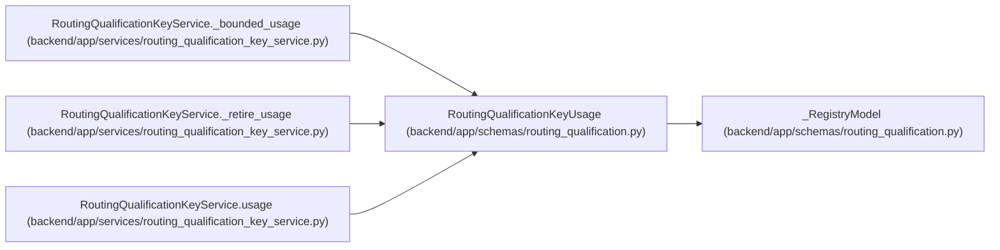

# RoutingQualificationKeyUsage

**Location:** `backend/app/schemas/routing_qualification.py:139`
**Kind:** Pydantic model
**Bases:** `_RegistryModel`
**Module:** [schemas_routing_qualification](../modules/schemas_routing_qualification.md)

## Description

Catalog entries, calibration contracts and tasks whose current routing assessment name the key.

## Attributes

| Name | Type | Wire name | Required | Nullable | Default | Constraints | Examples | Description |
|------|------|-----------|----------|----------|---------|-------------|-------------|----------|
| `catalog_entries` | `list[QualificationKeyCatalogReference]` | `catalog_entries` | No | No | factory: `list` | max_length=unknown (MAX_QUALIFICATION_KEY_USAGE_ITEMS) | — | — |
| `task_ids` | `list[int]` | `task_ids` | No | No | factory: `list` | max_length=unknown (MAX_QUALIFICATION_KEY_USAGE_ITEMS) | — | — |
| `catalog_entries_omitted` | `int` | `catalog_entries_omitted` | No | No | `0` | ge=0 | — | — |
| `task_ids_omitted` | `int` | `task_ids_omitted` | No | No | `0` | ge=0 | — | — |
| `calibration_contracts` | `list[QualificationKeyCalibrationReference]` | `calibration_contracts` | No | No | factory: `list` | max_length=unknown (MAX_QUALIFICATION_KEY_USAGE_ITEMS) | — | — |
| `calibration_contracts_omitted` | `int` | `calibration_contracts_omitted` | No | No | `0` | ge=0 | — | — |

## Methods

| Method | Signature | Decorators | Description |
|--------|-----------|------------|-------------|
| `in_use` | `() -> bool` | `@property` | — |

## Relationships

<!-- Auto-generated relationship summary. Do not edit by hand. -->

### Summary

| Module | Methods | Attributes |
|---|---:|---|
| [schemas_routing_qualification](../modules/schemas_routing_qualification.md) | 1 | `calibration_contracts`, `calibration_contracts_omitted`, `catalog_entries`, `catalog_entries_omitted`, `task_ids`, `task_ids_omitted` |

### Structure

| Kind | Entity | Module |
|---|---|---|
| Base | `_RegistryModel` | [schemas_routing_qualification](../modules/schemas_routing_qualification.md) |

### References

| Reference | Kind | Source | Call sites |
|---|---|---|---:|
| `RoutingQualificationKeyService._bounded_usage` | call | [routing_qualification_key_service](../modules/routing_qualification_key_service.md) | 1 |
| `RoutingQualificationKeyService._bounded_usage` | type_reference | [routing_qualification_key_service](../modules/routing_qualification_key_service.md) | — |
| `RoutingQualificationKeyService._retire_usage` | type_reference | [routing_qualification_key_service](../modules/routing_qualification_key_service.md) | — |
| `RoutingQualificationKeyService.usage` | type_reference | [routing_qualification_key_service](../modules/routing_qualification_key_service.md) | — |
