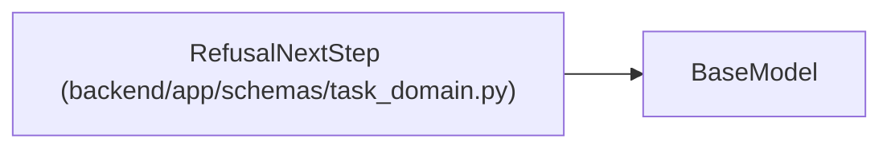

# RefusalNextStep

**Location:** `backend/app/schemas/task_domain.py:30`
**Kind:** Pydantic model
**Bases:** `BaseModel`
**Module:** [schemas_task_domain](../modules/schemas_task_domain.md)

## Description

What a person or agent may do about a refusal, from the shared refusal catalogue.

## Attributes

| Name | Type | Wire name | Required | Nullable | Default | Constraints | Examples | Description |
|------|------|-----------|----------|----------|---------|-------------|-------------|----------|
| `kind` | `str` | `kind` | Yes | No | — | — | — | Stable key for the step, such as record_provenance or accept_as_owner. |
| `authority` | `str` | `authority` | Yes | No | — | — | — | Who may take the step. |
| `message` | `str` | `message` | Yes | No | — | — | — | One sentence a person can act on. |
| `commands` | `dict[str, str]` | `commands` | No | No | factory: `dict` | — | — | The REST route or MCP tool that takes the step. |
| `ui_action` | `str \| None` | `ui_action` | No | Yes | `None` | — | — | The task page form that takes the step, when there is one. |

## Methods

*No declared methods.*

## Relationships

<!-- Auto-generated relationship summary. Do not edit by hand. -->

### Summary

| Module | Methods | Attributes |
|---|---:|---|
| [schemas_task_domain](../modules/schemas_task_domain.md) | 0 | `authority`, `commands`, `kind`, `message`, `ui_action` |

### Structure

| Kind | Entity | Module |
|---|---|---|
| Base | `BaseModel` | — |
