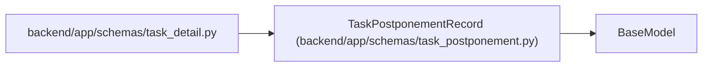

# TaskPostponementRecord

**Location:** `backend/app/schemas/task_postponement.py:136`
**Kind:** Pydantic model
**Bases:** `BaseModel`
**Module:** [schemas_task_postponement](../modules/schemas_task_postponement.md)

## Description

One postponement of a task: why and by whom, the status it came from, the execution ownership it released, its reactivation requirements, and how it ended (the status returned to, the trigger and who reactivated it). The trigger is `command`, `requirements_met` or `supersession`.

## Attributes

| Name | Type | Wire name | Required | Nullable | Default | Constraints | Examples | Description |
|------|------|-----------|----------|----------|---------|-------------|-------------|----------|
| `id` | `int` | `id` | Yes | No | — | — | — | — |
| `task_id` | `int` | `task_id` | Yes | No | — | — | — | — |
| `open` | `bool` | `open` | Yes | No | — | — | — | — |
| `from_status` | `Literal['planned', 'active', 'resolved']` | `from_status` | Yes | No | — | — | — | — |
| `reason` | `str` | `reason` | Yes | No | — | — | — | — |
| `postponed_at` | `datetime` | `postponed_at` | Yes | No | — | — | — | — |
| `postponed_by_principal_id` | `int \| None` | `postponed_by_principal_id` | No | Yes | `None` | — | — | — |
| `postponed_by_actor_id` | `int \| None` | `postponed_by_actor_id` | No | Yes | `None` | — | — | — |
| `task_version` | `int` | `task_version` | Yes | No | — | — | — | — |
| `released` | `PostponementRelease` | `released` | Yes | No | — | — | — | — |
| `requirements` | `list[ReactivationRequirementResponse]` | `requirements` | Yes | No | — | — | — | — |
| `reactivated_at` | `datetime \| None` | `reactivated_at` | No | Yes | `None` | — | — | — |
| `reactivated_to_status` | `Literal['planned', 'resolved'] \| None` | `reactivated_to_status` | No | Yes | `None` | — | — | — |
| `reactivation_trigger` | `str \| None` | `reactivation_trigger` | No | Yes | `None` | — | — | 'command' for an explicit reactivation, 'requirements_met' when the last requirement was met, 'supersession' when the postponed task was superseded by delivered work. |
| `reactivation_reason` | `str \| None` | `reactivation_reason` | No | Yes | `None` | — | — | — |
| `reactivated_by_principal_id` | `int \| None` | `reactivated_by_principal_id` | No | Yes | `None` | — | — | — |
| `reactivated_by_actor_id` | `int \| None` | `reactivated_by_actor_id` | No | Yes | `None` | — | — | — |

## Methods

*No declared methods.*

## Relationships

<!-- Auto-generated relationship summary. Do not edit by hand. -->

### Summary

| Module | Methods | Attributes |
|---|---:|---|
| [schemas_task_postponement](../modules/schemas_task_postponement.md) | 0 | `from_status`, `id`, `open`, `postponed_at`, `postponed_by_actor_id`, `postponed_by_principal_id`, `reactivated_at`, `reactivated_by_actor_id`, `reactivated_by_principal_id`, `reactivated_to_status`, `reactivation_reason`, `reactivation_trigger` |

### Structure

| Kind | Entity | Module |
|---|---|---|
| Base | `BaseModel` | — |

### References

| Reference | Kind | Source | Call sites |
|---|---|---|---:|
| `task_detail` | import | [task_detail](../modules/task_detail.md) | — |
