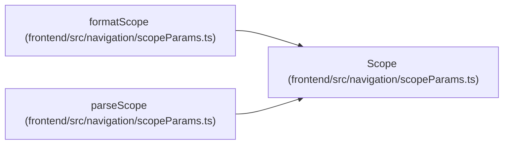

# Scope

**Location:** `frontend/src/navigation/scopeParams.ts:1`
**Kind:** Type alias
**Bases:** —
**Module:** [scopeParams](../modules/scopeParams.md)
**Target:**

```typescript
{ project: number | 'all'; iteration: number | 'backlog' }
```

## Description

_Auto-generated from `Scope` in `frontend/src/navigation/scopeParams.ts`._

## Attributes

*See the alias definition for its member types.*

## Methods

*See the alias definition for callable and member types.*

## Relationships

<!-- Auto-generated relationship summary. Do not edit by hand. -->


### Summary

| Module | Methods | Attributes |
|---|---:|---|
| [scopeParams](../modules/scopeParams.md) | 0 | — |

### References

| Reference | Kind | Source | Call sites |
|---|---|---|---:|
| `formatScope` | type_reference | [scopeParams](../modules/scopeParams.md) | — |
| `parseScope` | type_reference | [scopeParams](../modules/scopeParams.md) | — |
