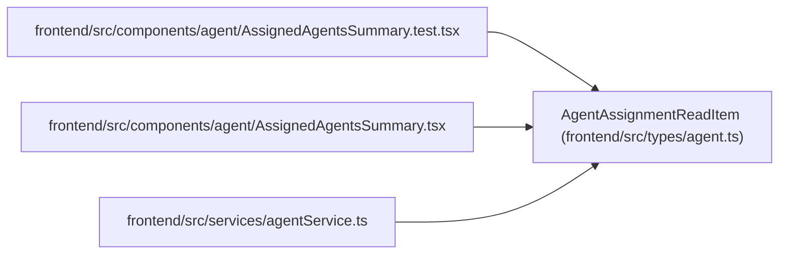

# AgentAssignmentReadItem

**Location:** `frontend/src/types/agent.ts:558`
**Kind:** Interface
**Bases:** —
**Module:** [types_agent](../modules/types_agent.md)

## Description

An assignment as a person reads it, without routing evidence or the assigner's reason.

## Attributes

| Name | Type | Required | Default | Description |
|------|------|----------|---------|-------------|
| `id` | `number` | Yes | — | — |
| `task_id` | `number` | Yes | — | — |
| `actor_id` | `number` | Yes | — | — |
| `actor` | `{ id: number; name: string; display_name: string \| null; role: string } \| null` | Yes | — | — |
| `team_member_id` | `number \| null` | Yes | — | — |
| `purpose` | `AgentAssignmentPurpose \| string` | Yes | — | — |
| `queue_class` | `AgentAssignmentQueueClass \| string` | Yes | — | — |
| `state` | `AgentAssignmentState \| string` | Yes | — | — |
| `queue_rank` | `number` | Yes | — | — |
| `not_before` | `string \| null` | Yes | — | — |
| `task_version` | `number` | Yes | — | — |
| `model_binding_id` | `number \| null` | Yes | — | — |
| `model_binding_revision` | `number \| null` | Yes | — | — |
| `model_binding_status` | `AgentModelBindingStatus` | Yes | — | — |
| `model_binding_stale_reasons` | `string[]` | Yes | — | — |
| `model` | `{ model_catalog_key: string; provider: string; configured_model_alias: string } \| null` | Yes | — | — |
| `created_at` | `string` | Yes | — | — |
| `updated_at` | `string` | Yes | — | — |

## Methods

*No declared methods.*

## Relationships

<!-- Auto-generated relationship summary. Do not edit by hand. -->

### Summary

| Module | Methods | Attributes |
|---|---:|---|
| [types_agent](../modules/types_agent.md) | 0 | `actor`, `actor_id`, `created_at`, `id`, `model`, `model_binding_id`, `model_binding_revision`, `model_binding_stale_reasons`, `model_binding_status`, `not_before`, `purpose`, `queue_class` |

### References

| Reference | Kind | Source | Call sites |
|---|---|---|---:|
| `AssignedAgentsSummary.test` | import | [AssignedAgentsSummary.test](../modules/AssignedAgentsSummary.test.md) | — |
| `AssignedAgentsSummary` | import | [AssignedAgentsSummary](../modules/AssignedAgentsSummary.md) | — |
| `agentService` | import | [agentService](../modules/agentService.md) | — |
