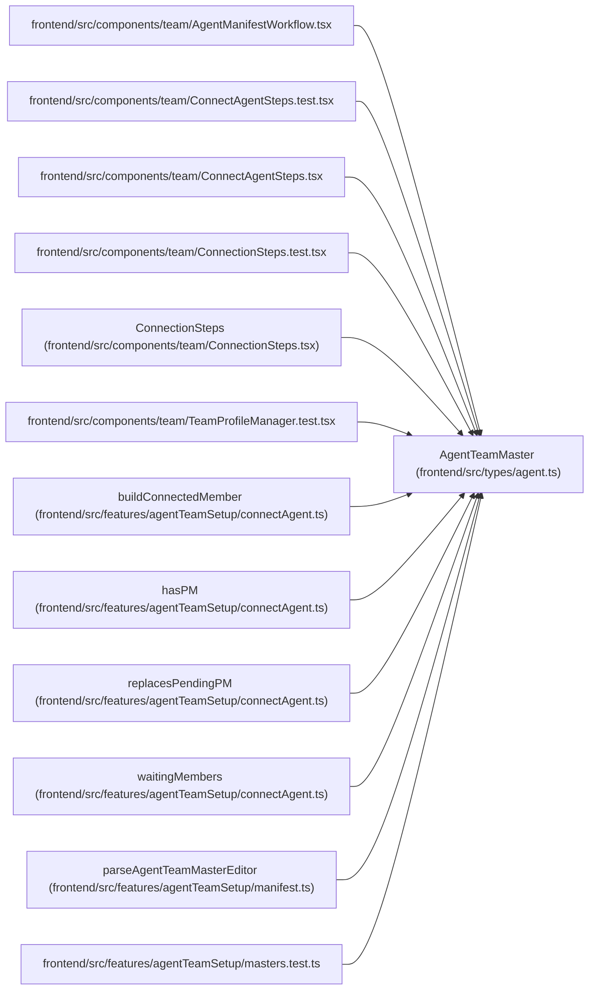

# AgentTeamMaster

**Location:** `frontend/src/types/agent.ts:777`
**Kind:** Interface
**Bases:** —
**Module:** [types_agent](../modules/types_agent.md)

## Description

_Auto-generated from `AgentTeamMaster` in `frontend/src/types/agent.ts`._

## Attributes

| Name | Type | Required | Default | Description |
|------|------|----------|---------|-------------|
| `schema_version` | `'agent-team-master-v1'` | Yes | — | — |
| `topology_key` | `string` | Yes | — | — |
| `server_url` | `string` | Yes | — | — |
| `credential_sink_ref` | `string` | Yes | — | — |
| `required_server_features` | `string[]` | Yes | — | — |
| `controller` | `AgentTeamMemberSpec` | Yes | — | — |
| `workers` | `AgentTeamMemberSpec[]` | Yes | — | — |
| `verifiers` | `AgentTeamMemberSpec[]` | Yes | — | — |
| `readiness_policy` | <pre><code>&#123;&#10;        minimum&#95;execution&#95;workers&#58; number&#59;&#10;        require&#95;independent&#95;verifier&#95;when&#95;assessed&#58; boolean&#59;&#10;        maximum&#95;runtime&#95;staleness&#95;seconds&#58; number&#59;&#10;    &#125;</code></pre> | Yes | — | — |

## Methods

*No declared methods.*

## Relationships

<!-- Auto-generated relationship summary. Do not edit by hand. -->

### Summary

| Module | Methods | Attributes |
|---|---:|---|
| [types_agent](../modules/types_agent.md) | 0 | `controller`, `credential_sink_ref`, `readiness_policy`, `required_server_features`, `schema_version`, `server_url`, `topology_key`, `verifiers`, `workers` |

### References

| Reference | Kind | Source | Call sites |
|---|---|---|---:|
| `AgentManifestWorkflow` | import | [AgentManifestWorkflow](../modules/AgentManifestWorkflow.md) | — |
| `ConnectAgentSteps.test` | import | [ConnectAgentSteps.test](../modules/ConnectAgentSteps.test.md) | — |
| `ConnectAgentSteps` | import | [ConnectAgentSteps](../modules/ConnectAgentSteps.md) | — |
| `ConnectionSteps.test` | import | [ConnectionSteps.test](../modules/ConnectionSteps.test.md) | — |
| `ConnectionSteps` | type_reference | [ConnectionSteps](../modules/ConnectionSteps.md) | — |
| `TeamProfileManager.test` | import | [TeamProfileManager.test](../modules/TeamProfileManager.test.md) | — |
| `buildConnectedMember` | type_reference | [connectAgent](../modules/connectAgent.md) | — |
| `hasPM` | type_reference | [connectAgent](../modules/connectAgent.md) | — |
| `replacesPendingPM` | type_reference | [connectAgent](../modules/connectAgent.md) | — |
| `waitingMembers` | type_reference | [connectAgent](../modules/connectAgent.md) | — |
| `parseAgentTeamMasterEditor` | type_reference | [agentTeamSetup_manifest](../modules/agentTeamSetup_manifest.md) | — |
| `masters.test` | import | [agentTeamSetup_masters.test](../modules/agentTeamSetup_masters.test.md) | — |

> References: showing 12 of 14 logical references; 2 omitted by the 12-row generated summary limit.
