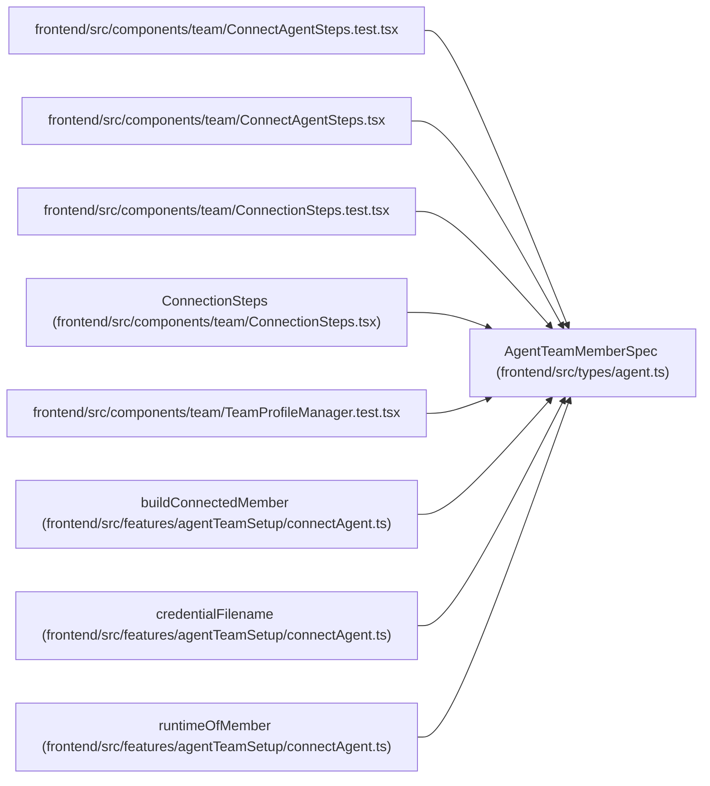

# AgentTeamMemberSpec

**Location:** `frontend/src/types/agent.ts:765`
**Kind:** Interface
**Bases:** —
**Module:** [types_agent](../modules/types_agent.md)

## Description

_Auto-generated from `AgentTeamMemberSpec` in `frontend/src/types/agent.ts`._

## Attributes

| Name | Type | Required | Default | Description |
|------|------|----------|---------|-------------|
| `actor_key` | `string` | Yes | — | — |
| `actor_name` | `string` | Yes | — | — |
| `display_name` | `string` | Yes | — | — |
| `role` | `AgentTeamRole` | Yes | — | — |
| `scope_preset` | `'pm-v1' \| 'worker-v1' \| 'verifier-v1'` | Yes | — | — |
| `profile_key` | `string` | Yes | — | — |
| `skill_package` | `AgentTeamSkillPackage` | Yes | — | — |
| `assignment_modes` | `string[]` | Yes | — | — |
| `model_binding_keys` | `string[]` | Yes | — | — |
| `default_model_binding_key` | `string` | Yes | — | — |
| `runtime_ref` | `string` | Yes | — | — |
| `credential_ref` | `string` | Yes | — | — |
| `declared_tool_tags` | `Record<string, string[]>` | No | — | — |

## Methods

*No declared methods.*

## Relationships

<!-- Auto-generated relationship summary. Do not edit by hand. -->

### Summary

| Module | Methods | Attributes |
|---|---:|---|
| [types_agent](../modules/types_agent.md) | 0 | `actor_key`, `actor_name`, `assignment_modes`, `credential_ref`, `declared_tool_tags`, `default_model_binding_key`, `display_name`, `model_binding_keys`, `profile_key`, `role`, `runtime_ref`, `scope_preset` |

### References

| Reference | Kind | Source | Call sites |
|---|---|---|---:|
| `ConnectAgentSteps.test` | import | [ConnectAgentSteps.test](../modules/ConnectAgentSteps.test.md) | — |
| `ConnectAgentSteps` | import | [ConnectAgentSteps](../modules/ConnectAgentSteps.md) | — |
| `ConnectionSteps.test` | import | [ConnectionSteps.test](../modules/ConnectionSteps.test.md) | — |
| `ConnectionSteps` | type_reference | [ConnectionSteps](../modules/ConnectionSteps.md) | — |
| `TeamProfileManager.test` | import | [TeamProfileManager.test](../modules/TeamProfileManager.test.md) | — |
| `buildConnectedMember` | type_reference | [connectAgent](../modules/connectAgent.md) | — |
| `credentialFilename` | type_reference | [connectAgent](../modules/connectAgent.md) | — |
| `runtimeOfMember` | type_reference | [connectAgent](../modules/connectAgent.md) | — |
