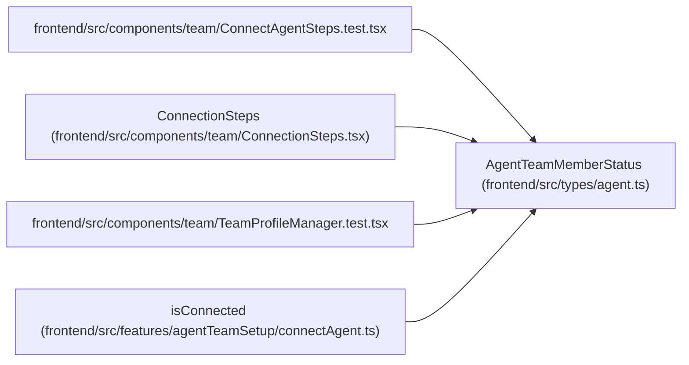

# AgentTeamMemberStatus

**Location:** `frontend/src/types/agent.ts:799`
**Kind:** Interface
**Bases:** —
**Module:** [types_agent](../modules/types_agent.md)

## Description

_Auto-generated from `AgentTeamMemberStatus` in `frontend/src/types/agent.ts`._

## Attributes

| Name | Type | Required | Default | Description |
|------|------|----------|---------|-------------|
| `actor_key` | `string` | Yes | — | — |
| `actor_id` | `number \| null` | Yes | — | — |
| `actor_name` | `string` | Yes | — | — |
| `display_name` | `string` | Yes | — | — |
| `role` | `AgentTeamRole` | Yes | — | — |
| `desired` | `boolean` | Yes | — | — |
| `configured` | `boolean` | Yes | — | — |
| `lifecycle_state` | `AgentTeamLifecycle` | Yes | — | — |
| `enabled` | `boolean` | Yes | — | — |
| `profile_key` | `string` | Yes | — | — |
| `profile_revision` | `string \| null` | Yes | — | — |
| `binding_revisions` | `Record<string, number>` | Yes | — | — |
| `skill_package` | `AgentTeamSkillPackage` | Yes | — | — |
| `package_acknowledged` | `boolean` | Yes | — | — |
| `acknowledgement_state` | `'missing' \| 'current' \| 'stale'` | No | — | — |
| `model_attestation` | `'not_independently_attested'` | No | — | — |
| `credential_delivery_state` | `'pending' \| 'delivered' \| 'uncertain' \| 'not_required'` | Yes | — | — |
| `connection_state` | `'unobserved' \| 'observed' \| 'stale'` | Yes | — | — |
| `last_seen_at` | `string \| null` | Yes | — | — |
| `queued_assignments` | `number \| null` | Yes | — | — |
| `accepted_assignments` | `number \| null` | Yes | — | — |
| `running_runs` | `number \| null` | Yes | — | — |
| `runtime_ready` | `boolean` | Yes | — | — |
| `availability` | `'availability_unknown'` | Yes | — | — |
| `blocker_codes` | `string[]` | Yes | — | — |
| `handoff` | `AgentTeamRuntimeHandoff \| null` | Yes | — | — |

## Methods

*No declared methods.*

## Relationships

<!-- Auto-generated relationship summary. Do not edit by hand. -->

### Summary

| Module | Methods | Attributes |
|---|---:|---|
| [types_agent](../modules/types_agent.md) | 0 | `accepted_assignments`, `acknowledgement_state`, `actor_id`, `actor_key`, `actor_name`, `availability`, `binding_revisions`, `blocker_codes`, `configured`, `connection_state`, `credential_delivery_state`, `desired` |

### References

| Reference | Kind | Source | Call sites |
|---|---|---|---:|
| `ConnectAgentSteps.test` | import | [ConnectAgentSteps.test](../modules/ConnectAgentSteps.test.md) | — |
| `ConnectionSteps` | type_reference | [ConnectionSteps](../modules/ConnectionSteps.md) | — |
| `TeamProfileManager.test` | import | [TeamProfileManager.test](../modules/TeamProfileManager.test.md) | — |
| `isConnected` | type_reference | [connectAgent](../modules/connectAgent.md) | — |
