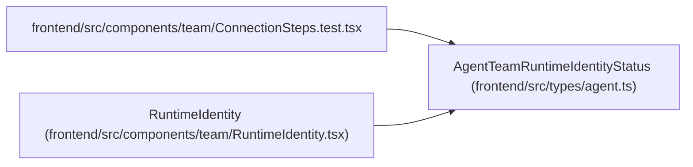

# AgentTeamRuntimeIdentityStatus

**Location:** `frontend/src/types/agent.ts:808`
**Kind:** Interface
**Bases:** —
**Module:** [types_agent](../modules/types_agent.md)

## Description

Which runtime instance acknowledged a member's handoff; unknown for an acknowledgement made before the identity existed.

## Attributes

| Name | Type | Required | Default | Description |
|------|------|----------|---------|-------------|
| `state` | `'unknown' \| 'current' \| 'changed' \| 'stale'` | Yes | — | — |
| `expected_instance_id` | `string \| null` | Yes | — | — |
| `acknowledged_instance_id` | `string \| null` | Yes | — | — |
| `previous_instance_id` | `string \| null` | Yes | — | — |
| `changed_at` | `string \| null` | Yes | — | — |
| `refused_instance_id` | `string \| null` | Yes | — | — |
| `refused_at` | `string \| null` | Yes | — | — |

## Methods

*No declared methods.*

## Relationships

<!-- Auto-generated relationship summary. Do not edit by hand. -->

### Summary

| Module | Methods | Attributes |
|---|---:|---|
| [types_agent](../modules/types_agent.md) | 0 | `acknowledged_instance_id`, `changed_at`, `expected_instance_id`, `previous_instance_id`, `refused_at`, `refused_instance_id`, `state` |

### References

| Reference | Kind | Source | Call sites |
|---|---|---|---:|
| `ConnectionSteps.test` | import | [ConnectionSteps.test](../modules/ConnectionSteps.test.md) | — |
| `RuntimeIdentity` | type_reference | [RuntimeIdentity](../modules/RuntimeIdentity.md) | — |
