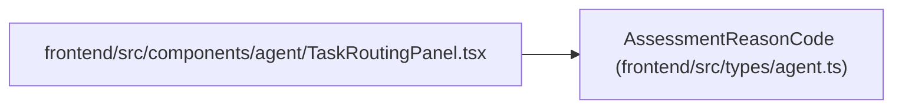

# AssessmentReasonCode

**Location:** `frontend/src/types/agent.ts:24`
**Kind:** Type alias
**Bases:** —
**Module:** [types_agent](../modules/types_agent.md)
**Target:**

```typescript
| 'novel-architecture'
    | 'material-ambiguity'
    | 'broad-context'
    | 'security'
    | 'authorization'
    | 'migration'
    | 'data-integrity'
    | 'concurrency'
    | 'production'
    | 'irreversible-change'
    | 'independent-verification'
    | 'specialist-verification'
```

## Description

_Auto-generated from `AssessmentReasonCode` in `frontend/src/types/agent.ts`._

## Attributes

*See the alias definition for its member types.*

## Methods

*See the alias definition for callable and member types.*

## Relationships

<!-- Auto-generated relationship summary. Do not edit by hand. -->


### Summary

| Module | Methods | Attributes |
|---|---:|---|
| [types_agent](../modules/types_agent.md) | 0 | — |

### References

| Reference | Kind | Source | Call sites |
|---|---|---|---:|
| `TaskRoutingPanel` | import | [TaskRoutingPanel](../modules/TaskRoutingPanel.md) | — |
