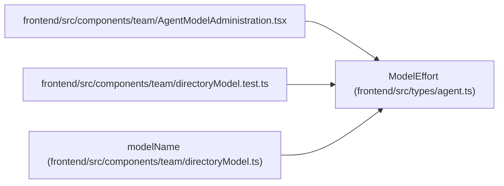

# ModelEffort

**Location:** `frontend/src/types/agent.ts:16`
**Kind:** Type alias
**Bases:** —
**Module:** [types_agent](../modules/types_agent.md)
**Target:**

```typescript
'unknown' | 'low' | 'medium' | 'high' | 'xhigh' | 'max'
```

## Description

_Auto-generated from `ModelEffort` in `frontend/src/types/agent.ts`._

## Attributes

*See the alias definition for its member types.*

## Methods

*See the alias definition for callable and member types.*

## Relationships

<!-- Auto-generated relationship summary. Do not edit by hand. -->


### Summary

| Module | Methods | Attributes |
|---|---:|---|
| [types_agent](../modules/types_agent.md) | 0 | — |

### References

| Reference | Kind | Source | Call sites |
|---|---|---|---:|
| `AgentModelAdministration` | import | [AgentModelAdministration](../modules/AgentModelAdministration.md) | — |
| `directoryModel.test` | import | [directoryModel.test](../modules/directoryModel.test.md) | — |
| `modelName` | type_reference | [directoryModel](../modules/directoryModel.md) | — |
