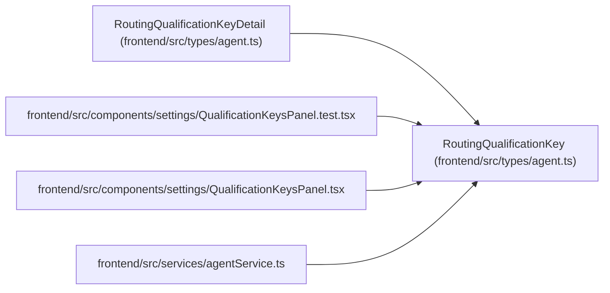

# RoutingQualificationKey

**Location:** `frontend/src/types/agent.ts:318`
**Kind:** Interface
**Bases:** —
**Module:** [types_agent](../modules/types_agent.md)

## Description

A deployment-declared key that catalog entries and task requirements may name.

## Attributes

| Name | Type | Required | Default | Description |
|------|------|----------|---------|-------------|
| `id` | `number` | Yes | — | — |
| `key` | `string` | Yes | — | — |
| `label` | `string` | Yes | — | — |
| `description` | `string \| null` | Yes | — | — |
| `state` | `RoutingQualificationKeyState` | Yes | — | — |
| `revision` | `number` | Yes | — | — |
| `created_at` | `string` | Yes | — | — |
| `updated_at` | `string` | Yes | — | — |
| `retired_at` | `string \| null` | Yes | — | — |

## Methods

*No declared methods.*

## Relationships

<!-- Auto-generated relationship summary. Do not edit by hand. -->

### Summary

| Module | Methods | Attributes |
|---|---:|---|
| [types_agent](../modules/types_agent.md) | 0 | `created_at`, `description`, `id`, `key`, `label`, `retired_at`, `revision`, `state`, `updated_at` |

### Structure

| Kind | Entity | Module |
|---|---|---|
| Subclass | `RoutingQualificationKeyDetail` | [types_agent](../modules/types_agent.md) |

### References

| Reference | Kind | Source | Call sites |
|---|---|---|---:|
| `QualificationKeysPanel.test` | import | [QualificationKeysPanel.test](../modules/QualificationKeysPanel.test.md) | — |
| `QualificationKeysPanel` | import | [QualificationKeysPanel](../modules/QualificationKeysPanel.md) | — |
| `agentService` | import | [agentService](../modules/agentService.md) | — |
