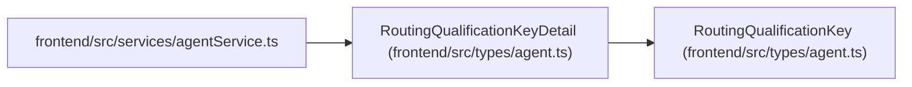

# RoutingQualificationKeyDetail

**Location:** `frontend/src/types/agent.ts:350`
**Kind:** Interface
**Bases:** `RoutingQualificationKey`
**Module:** [types_agent](../modules/types_agent.md)

## Description

_Auto-generated from `RoutingQualificationKeyDetail` in `frontend/src/types/agent.ts`._

## Attributes

| Name | Type | Required | Default | Description |
|------|------|----------|---------|-------------|
| `revisions` | `RoutingQualificationKeyRevision[]` | Yes | — | — |
| `usage` | `RoutingQualificationKeyUsage` | Yes | — | — |

## Methods

*No declared methods.*

## Relationships

<!-- Auto-generated relationship summary. Do not edit by hand. -->

### Summary

| Module | Methods | Attributes |
|---|---:|---|
| [types_agent](../modules/types_agent.md) | 0 | `revisions`, `usage` |

### Structure

| Kind | Entity | Module |
|---|---|---|
| Base | `RoutingQualificationKey` | [types_agent](../modules/types_agent.md) |

### References

| Reference | Kind | Source | Call sites |
|---|---|---|---:|
| `agentService` | import | [agentService](../modules/agentService.md) | — |
