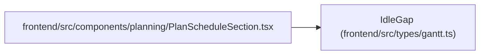

# IdleGap

**Location:** `frontend/src/types/gantt.ts:122`
**Kind:** Interface
**Bases:** —
**Module:** [types_gantt](../modules/types_gantt.md)

## Description

Working days an assignee is left idle before the task that follows them on the row.

## Attributes

| Name | Type | Required | Default | Description |
|------|------|----------|---------|-------------|
| `start_date` | `string` | Yes | — | — |
| `end_date` | `string` | Yes | — | — |
| `working_days` | `number` | Yes | — | — |
| `task_id` | `number` | Yes | — | — |
| `task_title` | `string` | Yes | — | — |
| `reason` | `IdleReason` | Yes | — | — |
| `waiting_on` | `WaitingOnTask` | No | — | — |
| `earliest_start` | `string` | No | — | — |
| `message` | `string` | Yes | — | — |

## Methods

*No declared methods.*

## Relationships

<!-- Auto-generated relationship summary. Do not edit by hand. -->

### Summary

| Module | Methods | Attributes |
|---|---:|---|
| [types_gantt](../modules/types_gantt.md) | 0 | `earliest_start`, `end_date`, `message`, `reason`, `start_date`, `task_id`, `task_title`, `waiting_on`, `working_days` |

### References

| Reference | Kind | Source | Call sites |
|---|---|---|---:|
| `PlanScheduleSection` | import | [PlanScheduleSection](../modules/PlanScheduleSection.md) | — |
