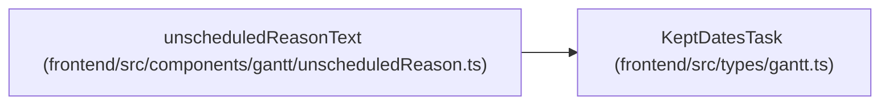

# KeptDatesTask

**Location:** `frontend/src/types/gantt.ts:108`
**Kind:** Interface
**Bases:** —
**Module:** [types_gantt](../modules/types_gantt.md)

## Description

A planned task the scheduler could not place; it keeps the dates it already had.

## Attributes

| Name | Type | Required | Default | Description |
|------|------|----------|---------|-------------|
| `task_id` | `number` | Yes | — | — |
| `task_title` | `string` | Yes | — | — |
| `reason` | `UnscheduledReason` | Yes | — | — |
| `message` | `string` | Yes | — | — |
| `start_date` | `string` | Yes | — | — |
| `end_date` | `string` | Yes | — | — |
| `date_rule` | `DateRule` | No | — | — |
| `also` | `UnscheduledReason[]` | No | — | — |
| `waiting_on` | `WaitingOnTask[]` | No | — | — |

## Methods

*No declared methods.*

## Relationships

<!-- Auto-generated relationship summary. Do not edit by hand. -->

### Summary

| Module | Methods | Attributes |
|---|---:|---|
| [types_gantt](../modules/types_gantt.md) | 0 | `also`, `date_rule`, `end_date`, `message`, `reason`, `start_date`, `task_id`, `task_title`, `waiting_on` |

### References

| Reference | Kind | Source | Call sites |
|---|---|---|---:|
| `unscheduledReasonText` | type_reference | [unscheduledReason](../modules/unscheduledReason.md) | — |
