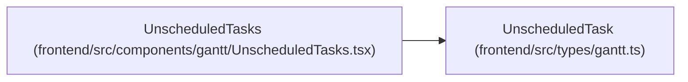

# UnscheduledTask

**Location:** `frontend/src/types/gantt.ts:70`
**Kind:** Interface
**Bases:** —
**Module:** [types_gantt](../modules/types_gantt.md)

## Description

A planned task the scheduler left without dates, with the cause and the server's English hint.

## Attributes

| Name | Type | Required | Default | Description |
|------|------|----------|---------|-------------|
| `task_id` | `number` | Yes | — | — |
| `task_title` | `string` | Yes | — | — |
| `reason` | `UnscheduledReason` | Yes | — | — |
| `message` | `string` | Yes | — | — |

## Methods

*No declared methods.*

## Relationships

<!-- Auto-generated relationship summary. Do not edit by hand. -->

### Summary

| Module | Methods | Attributes |
|---|---:|---|
| [types_gantt](../modules/types_gantt.md) | 0 | `message`, `reason`, `task_id`, `task_title` |

### References

| Reference | Kind | Source | Call sites |
|---|---|---|---:|
| `UnscheduledTasks` | type_reference | [UnscheduledTasks](../modules/UnscheduledTasks.md) | — |
