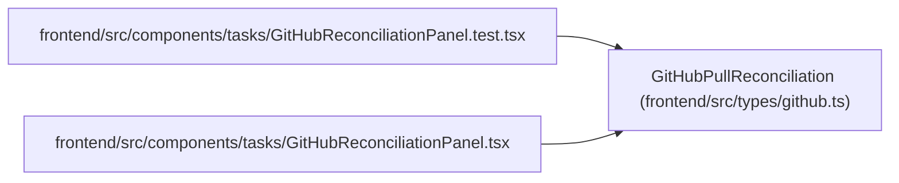

# GitHubPullReconciliation

**Location:** `frontend/src/types/github.ts:59`
**Kind:** Interface
**Bases:** —
**Module:** [types_github](../modules/types_github.md)

## Description

One linked pull request set against the commits submitted for the task: observed state, head, checks, target branch, merge or closure facts, observation source and error, review state, the differences found and who acts next.

## Attributes

| Name | Type | Required | Default | Description |
|------|------|----------|---------|-------------|
| `link_id` | `number` | Yes | — | — |
| `url` | `string \| null` | No | — | — |
| `title` | `string \| null` | No | — | — |
| `state` | `string` | Yes | — | — |
| `submitted_sha` | `string \| null` | No | — | — |
| `submissions` | `GitHubPullSubmission[]` | Yes | — | — |
| `observed_head_sha` | `string \| null` | No | — | — |
| `target_branch` | `string \| null` | No | — | — |
| `checks` | `{ state?: string \| null; total?: number \| null; sha?: string \| null; error?: string \| null }` | Yes | — | — |
| `merged` | `boolean` | Yes | — | — |
| `merge_commit_sha` | `string \| null` | No | — | — |
| `merged_at` | `string \| null` | No | — | — |
| `closed_at` | `string \| null` | No | — | — |
| `observed_at` | `string \| null` | No | — | — |
| `observation_source` | `string \| null` | No | — | — |
| `observation_error` | `string \| null` | No | — | — |
| `review` | `{ accepted: boolean; state: string }` | Yes | — | — |
| `differences` | `string[]` | Yes | — | — |
| `next_owner` | `string` | Yes | — | — |
| `next_action` | `string` | Yes | — | — |

## Methods

*No declared methods.*

## Relationships

<!-- Auto-generated relationship summary. Do not edit by hand. -->

### Summary

| Module | Methods | Attributes |
|---|---:|---|
| [types_github](../modules/types_github.md) | 0 | `checks`, `closed_at`, `differences`, `link_id`, `merge_commit_sha`, `merged`, `merged_at`, `next_action`, `next_owner`, `observation_error`, `observation_source`, `observed_at` |

### References

| Reference | Kind | Source | Call sites |
|---|---|---|---:|
| `GitHubReconciliationPanel.test` | import | [GitHubReconciliationPanel.test](../modules/GitHubReconciliationPanel.test.md) | — |
| `GitHubReconciliationPanel` | import | [GitHubReconciliationPanel](../modules/GitHubReconciliationPanel.md) | — |
