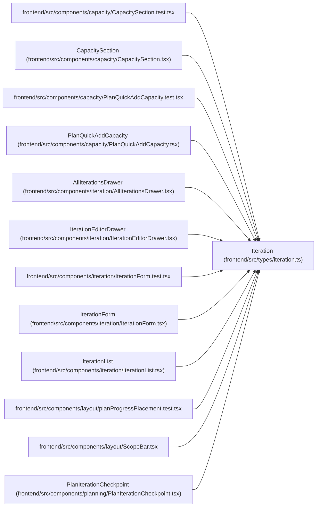

# Iteration

**Location:** `frontend/src/types/iteration.ts:9`
**Kind:** Interface
**Bases:** —
**Module:** [types_iteration](../modules/types_iteration.md)

## Description

_Auto-generated from `Iteration` in `frontend/src/types/iteration.ts`._

## Attributes

| Name | Type | Required | Default | Description |
|------|------|----------|---------|-------------|
| `nominal_day_hours` | `number` | No | — | — |
| `revision` | `number` | No | — | — |
| `id` | `number` | Yes | — | — |
| `name` | `string` | Yes | — | — |
| `calendar_id` | `number` | Yes | — | — |
| `project_id` | `number \| null` | No | — | — |
| `project` | `IterationProject \| null` | No | — | — |
| `start_date` | `string` | Yes | — | — |
| `end_date` | `string` | Yes | — | — |
| `manager_email` | `string` | No | — | — |
| `working_days` | `number` | Yes | — | — |

## Methods

*No declared methods.*

## Relationships

<!-- Auto-generated relationship summary. Do not edit by hand. -->

### Summary

| Module | Methods | Attributes |
|---|---:|---|
| [types_iteration](../modules/types_iteration.md) | 0 | `calendar_id`, `end_date`, `id`, `manager_email`, `name`, `nominal_day_hours`, `project`, `project_id`, `revision`, `start_date`, `working_days` |

### References

| Reference | Kind | Source | Call sites |
|---|---|---|---:|
| `CapacitySection.test` | import | [CapacitySection.test](../modules/CapacitySection.test.md) | — |
| `CapacitySection` | type_reference | [CapacitySection](../modules/CapacitySection.md) | — |
| `PlanQuickAddCapacity.test` | import | [PlanQuickAddCapacity.test](../modules/PlanQuickAddCapacity.test.md) | — |
| `PlanQuickAddCapacity` | type_reference | [PlanQuickAddCapacity](../modules/PlanQuickAddCapacity.md) | — |
| `AllIterationsDrawer` | type_reference | [AllIterationsDrawer](../modules/AllIterationsDrawer.md) | — |
| `IterationEditorDrawer` | type_reference | [IterationEditorDrawer](../modules/IterationEditorDrawer.md) | — |
| `IterationForm.test` | import | [IterationForm.test](../modules/IterationForm.test.md) | — |
| `IterationForm` | type_reference | [IterationForm](../modules/IterationForm.md) | — |
| `IterationList` | type_reference | [IterationList](../modules/IterationList.md) | — |
| `planProgressPlacement.test` | import | [planProgressPlacement.test](../modules/planProgressPlacement.test.md) | — |
| `ScopeBar` | import | [ScopeBar](../modules/ScopeBar.md) | — |
| `PlanIterationCheckpoint` | type_reference | [PlanIterationCheckpoint](../modules/PlanIterationCheckpoint.md) | — |

> References: showing 12 of 44 logical references; 32 omitted by the 12-row generated summary limit.
