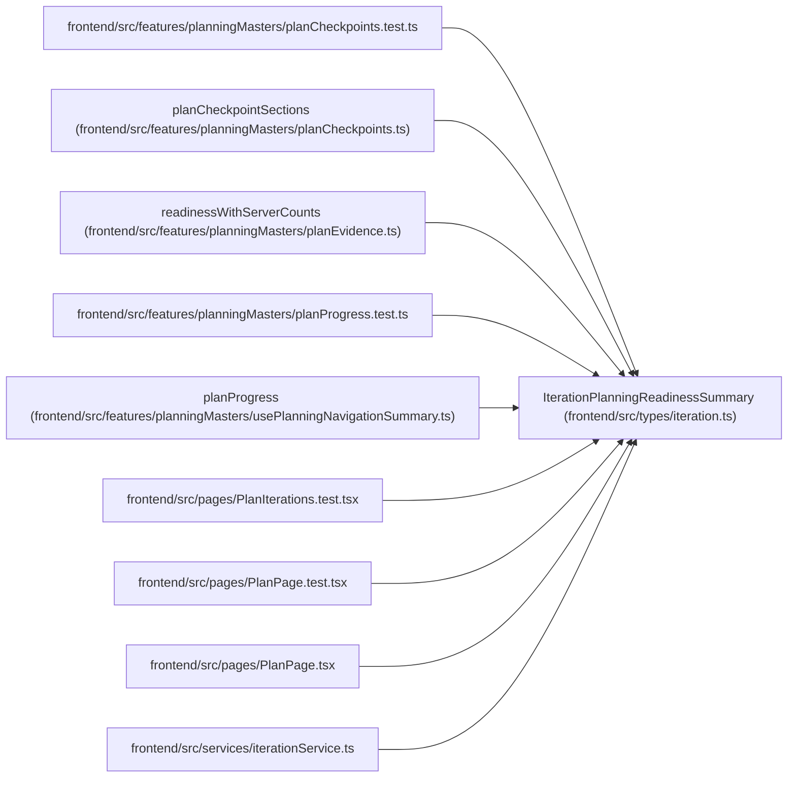

# IterationPlanningReadinessSummary

**Location:** `frontend/src/types/iteration.ts:88`
**Kind:** Interface
**Bases:** —
**Module:** [types_iteration](../modules/types_iteration.md)

## Description

_Auto-generated from `IterationPlanningReadinessSummary` in `frontend/src/types/iteration.ts`._

## Attributes

| Name | Type | Required | Default | Description |
|------|------|----------|---------|-------------|
| `iteration_id` | `number` | Yes | — | — |
| `calendar_name` | `string \| null` | No | — | — |
| `additional_calendar_ids` | `number[]` | No | — | — |
| `missing_calendar_years` | `number[]` | No | — | — |
| `team_member_count` | `number` | Yes | — | — |
| `team_capacity_hours` | `number` | Yes | — | — |
| `planned_hours` | `number` | No | — | — |
| `assigned_hours` | `number` | No | — | — |
| `team_members_no_capacity` | `number` | Yes | — | — |
| `task_count` | `number` | Yes | — | — |
| `tasks_without_assignee` | `number` | Yes | — | — |
| `tasks_without_effort` | `number` | Yes | — | — |
| `tasks_agent_without_capacity` | `number` | No | — | — |
| `team_agent_count` | `number` | No | — | — |
| `has_schedule` | `boolean` | Yes | — | — |
| `risk_count` | `number` | Yes | — | — |
| `inverted_dependencies` | <pre><code>Array&#60;&#123;&#10;        task&#95;id&#58; number&#59;&#10;        task&#95;title&#58; string&#59;&#10;        task&#95;start&#95;date&#58; string&#59;&#10;        prerequisite&#95;id&#58; number&#59;&#10;        prerequisite&#95;title&#58; string&#59;&#10;        prerequisite&#95;end&#95;date&#58; string&#59;&#10;    &#125;&#62;</code></pre> | No | — | — |
| `checkpoints` | `PlanCheckpoint[]` | No | — | — |
| `checkpoints_done` | `number` | No | — | — |
| `checkpoints_total` | `number` | No | — | — |

## Methods

*No declared methods.*

## Relationships

<!-- Auto-generated relationship summary. Do not edit by hand. -->

### Summary

| Module | Methods | Attributes |
|---|---:|---|
| [types_iteration](../modules/types_iteration.md) | 0 | `additional_calendar_ids`, `assigned_hours`, `calendar_name`, `checkpoints`, `checkpoints_done`, `checkpoints_total`, `has_schedule`, `inverted_dependencies`, `iteration_id`, `missing_calendar_years`, `planned_hours`, `risk_count` |

### References

| Reference | Kind | Source | Call sites |
|---|---|---|---:|
| `planCheckpoints.test` | import | [planCheckpoints.test](../modules/planCheckpoints.test.md) | — |
| `planCheckpointSections` | type_reference | [planCheckpoints](../modules/planCheckpoints.md) | — |
| `readinessWithServerCounts` | type_reference | [planEvidence](../modules/planEvidence.md) | — |
| `planProgress.test` | import | [planProgress.test](../modules/planProgress.test.md) | — |
| `planProgress` | type_reference | [usePlanningNavigationSummary](../modules/usePlanningNavigationSummary.md) | — |
| `PlanIterations.test` | import | [PlanIterations.test](../modules/PlanIterations.test.md) | — |
| `PlanPage.test` | import | [PlanPage.test](../modules/PlanPage.test.md) | — |
| `PlanPage` | import | [PlanPage](../modules/PlanPage.md) | — |
| `iterationService` | import | [iterationService](../modules/iterationService.md) | — |
