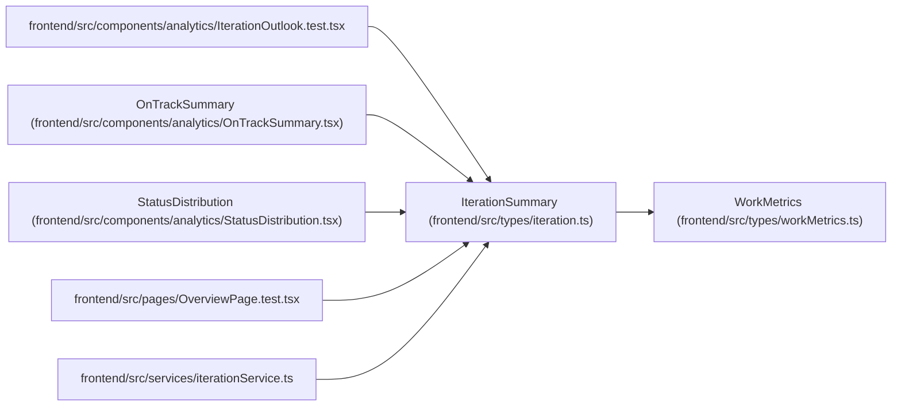

# IterationSummary

**Location:** `frontend/src/types/iteration.ts:59`
**Kind:** Interface
**Bases:** `WorkMetrics`
**Module:** [types_iteration](../modules/types_iteration.md)

## Description

_Auto-generated from `IterationSummary` in `frontend/src/types/iteration.ts`._

## Attributes

| Name | Type | Required | Default | Description |
|------|------|----------|---------|-------------|
| `id` | `number` | Yes | — | — |
| `name` | `string` | Yes | — | — |
| `project_id` | `number \| null` | No | — | — |
| `project` | `IterationProject \| null` | No | — | — |
| `start_date` | `string` | Yes | — | — |
| `end_date` | `string` | Yes | — | — |
| `working_days` | `number` | Yes | — | — |
| `total_tasks` | `number` | Yes | — | — |
| `completed_tasks` | `number` | Yes | — | — |
| `total_effort_days` | `number` | Yes | — | — |
| `team_capacity_days` | `number` | Yes | — | — |
| `overdue_tasks_count` | `number` | Yes | — | — |
| `status_counts` | `Partial<Record<'planned' \| 'active' \| 'resolved' \| 'closed', number>>` | No | — | — |
| `blocked_tasks` | `number` | No | — | — |
| `remaining_effort_days` | `number` | No | — | — |
| `unknown_estimate_tasks` | `number` | No | — | — |
| `scheduled_finish` | `string \| null` | No | — | — |
| `remaining_working_days` | `number \| null` | No | — | — |

## Methods

*No declared methods.*

## Relationships

<!-- Auto-generated relationship summary. Do not edit by hand. -->

### Summary

| Module | Methods | Attributes |
|---|---:|---|
| [types_iteration](../modules/types_iteration.md) | 0 | `blocked_tasks`, `completed_tasks`, `end_date`, `id`, `name`, `overdue_tasks_count`, `project`, `project_id`, `remaining_effort_days`, `remaining_working_days`, `scheduled_finish`, `start_date` |

### Structure

| Kind | Entity | Module |
|---|---|---|
| Base | `WorkMetrics` | [workMetrics](../modules/workMetrics.md) |

### References

| Reference | Kind | Source | Call sites |
|---|---|---|---:|
| `IterationOutlook.test` | import | [IterationOutlook.test](../modules/IterationOutlook.test.md) | — |
| `OnTrackSummary` | type_reference | [OnTrackSummary](../modules/OnTrackSummary.md) | — |
| `StatusDistribution` | type_reference | [StatusDistribution](../modules/StatusDistribution.md) | — |
| `OverviewPage.test` | import | [OverviewPage.test](../modules/OverviewPage.test.md) | — |
| `iterationService` | import | [iterationService](../modules/iterationService.md) | — |
