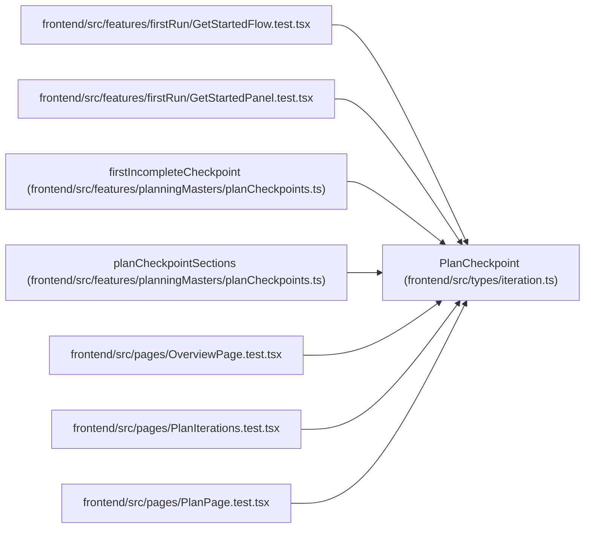

# PlanCheckpoint

**Location:** `frontend/src/types/iteration.ts:112`
**Kind:** Interface
**Bases:** —
**Module:** [types_iteration](../modules/types_iteration.md)

## Description

_Auto-generated from `PlanCheckpoint` in `frontend/src/types/iteration.ts`._

## Attributes

| Name | Type | Required | Default | Description |
|------|------|----------|---------|-------------|
| `id` | `'iteration' \| 'team' \| 'work' \| 'blockers' \| 'schedule' \| 'review'` | Yes | — | — |
| `state` | `'done' \| 'warn' \| 'todo' \| 'blocked'` | Yes | — | — |
| `reason_codes` | `string[]` | Yes | — | — |
| `counts` | `Record<string, number>` | Yes | — | — |

## Methods

*No declared methods.*

## Relationships

<!-- Auto-generated relationship summary. Do not edit by hand. -->

### Summary

| Module | Methods | Attributes |
|---|---:|---|
| [types_iteration](../modules/types_iteration.md) | 0 | `counts`, `id`, `reason_codes`, `state` |

### References

| Reference | Kind | Source | Call sites |
|---|---|---|---:|
| `GetStartedFlow.test` | import | [GetStartedFlow.test](../modules/GetStartedFlow.test.md) | — |
| `GetStartedPanel.test` | import | [GetStartedPanel.test](../modules/GetStartedPanel.test.md) | — |
| `firstIncompleteCheckpoint` | type_reference | [planCheckpoints](../modules/planCheckpoints.md) | — |
| `planCheckpointSections` | type_reference | [planCheckpoints](../modules/planCheckpoints.md) | — |
| `OverviewPage.test` | import | [OverviewPage.test](../modules/OverviewPage.test.md) | — |
| `PlanIterations.test` | import | [PlanIterations.test](../modules/PlanIterations.test.md) | — |
| `PlanPage.test` | import | [PlanPage.test](../modules/PlanPage.test.md) | — |
