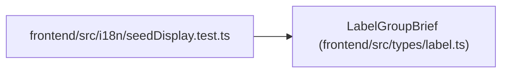

# LabelGroupBrief

**Location:** `frontend/src/types/label.ts:1`
**Kind:** Interface
**Bases:** —
**Module:** [types_label](../modules/types_label.md)

## Description

_Auto-generated from `LabelGroupBrief` in `frontend/src/types/label.ts`._

## Attributes

| Name | Type | Required | Default | Description |
|------|------|----------|---------|-------------|
| `id` | `number` | Yes | — | — |
| `key` | `string` | Yes | — | — |
| `name` | `string` | Yes | — | — |
| `color` | `string` | Yes | — | — |
| `is_active` | `boolean` | Yes | — | — |

## Methods

*No declared methods.*

## Relationships

<!-- Auto-generated relationship summary. Do not edit by hand. -->

### Summary

| Module | Methods | Attributes |
|---|---:|---|
| [types_label](../modules/types_label.md) | 0 | `color`, `id`, `is_active`, `key`, `name` |

### References

| Reference | Kind | Source | Call sites |
|---|---|---|---:|
| `seedDisplay.test` | import | [seedDisplay.test](../modules/seedDisplay.test.md) | — |
