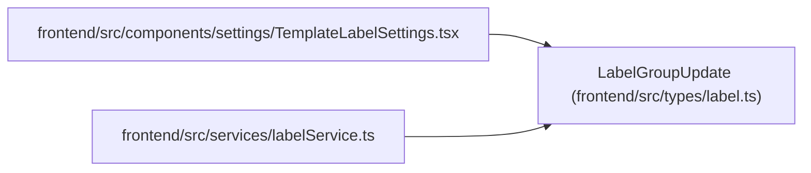

# LabelGroupUpdate

**Location:** `frontend/src/types/label.ts:47`
**Kind:** Type alias
**Bases:** —
**Module:** [types_label](../modules/types_label.md)
**Target:**

```typescript
Partial<LabelGroupCreate>
```

## Description

_Auto-generated from `LabelGroupUpdate` in `frontend/src/types/label.ts`._

## Attributes

*See the alias definition for its member types.*

## Methods

*See the alias definition for callable and member types.*

## Relationships

<!-- Auto-generated relationship summary. Do not edit by hand. -->


### Summary

| Module | Methods | Attributes |
|---|---:|---|
| [types_label](../modules/types_label.md) | 0 | — |

### References

| Reference | Kind | Source | Call sites |
|---|---|---|---:|
| `TemplateLabelSettings` | import | [TemplateLabelSettings](../modules/TemplateLabelSettings.md) | — |
| `labelService` | import | [labelService](../modules/labelService.md) | — |
