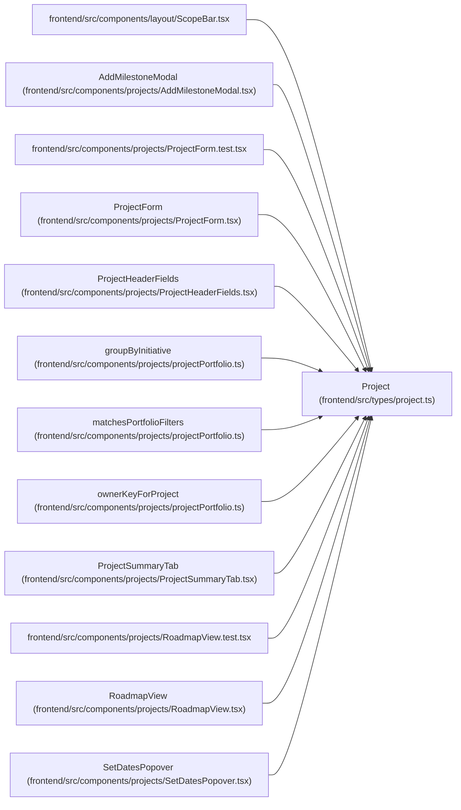

# Project

**Location:** `frontend/src/types/project.ts:56`
**Kind:** Interface
**Bases:** —
**Module:** [types_project](../modules/types_project.md)

## Description

_Auto-generated from `Project` in `frontend/src/types/project.ts`._

## Attributes

| Name | Type | Required | Default | Description |
|------|------|----------|---------|-------------|
| `id` | `number` | Yes | — | — |
| `name` | `string` | Yes | — | — |
| `description` | `string \| null` | No | — | — |
| `status` | `ProjectStatus` | Yes | — | — |
| `health` | `ProjectHealth` | Yes | — | — |
| `owner_id` | `number \| null` | Yes | — | — |
| `owner` | `ProjectOwner \| null` | Yes | — | — |
| `owner_profile_id` | `number \| null` | Yes | — | — |
| `owner_profile` | `ProjectProfileOwner \| null` | Yes | — | — |
| `initiative_id` | `number \| null` | No | — | — |
| `initiative` | `ProjectInitiativeSummary \| null` | No | — | — |
| `start_date` | `string \| null` | No | — | — |
| `target_date` | `string \| null` | No | — | — |
| `completed_at` | `string \| null` | No | — | — |
| `sort_order` | `number` | Yes | — | — |
| `created_at` | `string` | Yes | — | — |
| `updated_at` | `string` | Yes | — | — |

## Methods

*No declared methods.*

## Relationships

<!-- Auto-generated relationship summary. Do not edit by hand. -->

### Summary

| Module | Methods | Attributes |
|---|---:|---|
| [types_project](../modules/types_project.md) | 0 | `completed_at`, `created_at`, `description`, `health`, `id`, `initiative`, `initiative_id`, `name`, `owner`, `owner_id`, `owner_profile`, `owner_profile_id` |

### References

| Reference | Kind | Source | Call sites |
|---|---|---|---:|
| `ScopeBar` | import | [ScopeBar](../modules/ScopeBar.md) | — |
| `AddMilestoneModal` | type_reference | [AddMilestoneModal](../modules/AddMilestoneModal.md) | — |
| `ProjectForm.test` | import | [ProjectForm.test](../modules/ProjectForm.test.md) | — |
| `ProjectForm` | type_reference | [ProjectForm](../modules/ProjectForm.md) | — |
| `ProjectHeaderFields` | type_reference | [ProjectHeaderFields](../modules/ProjectHeaderFields.md) | — |
| `groupByInitiative` | type_reference | [projectPortfolio](../modules/projectPortfolio.md) | — |
| `matchesPortfolioFilters` | type_reference | [projectPortfolio](../modules/projectPortfolio.md) | — |
| `ownerKeyForProject` | type_reference | [projectPortfolio](../modules/projectPortfolio.md) | — |
| `ProjectSummaryTab` | type_reference | [ProjectSummaryTab](../modules/ProjectSummaryTab.md) | — |
| `RoadmapView.test` | import | [RoadmapView.test](../modules/RoadmapView.test.md) | — |
| `RoadmapView` | type_reference | [RoadmapView](../modules/RoadmapView.md) | — |
| `SetDatesPopover` | type_reference | [SetDatesPopover](../modules/SetDatesPopover.md) | — |

> References: showing 12 of 23 logical references; 11 omitted by the 12-row generated summary limit.
