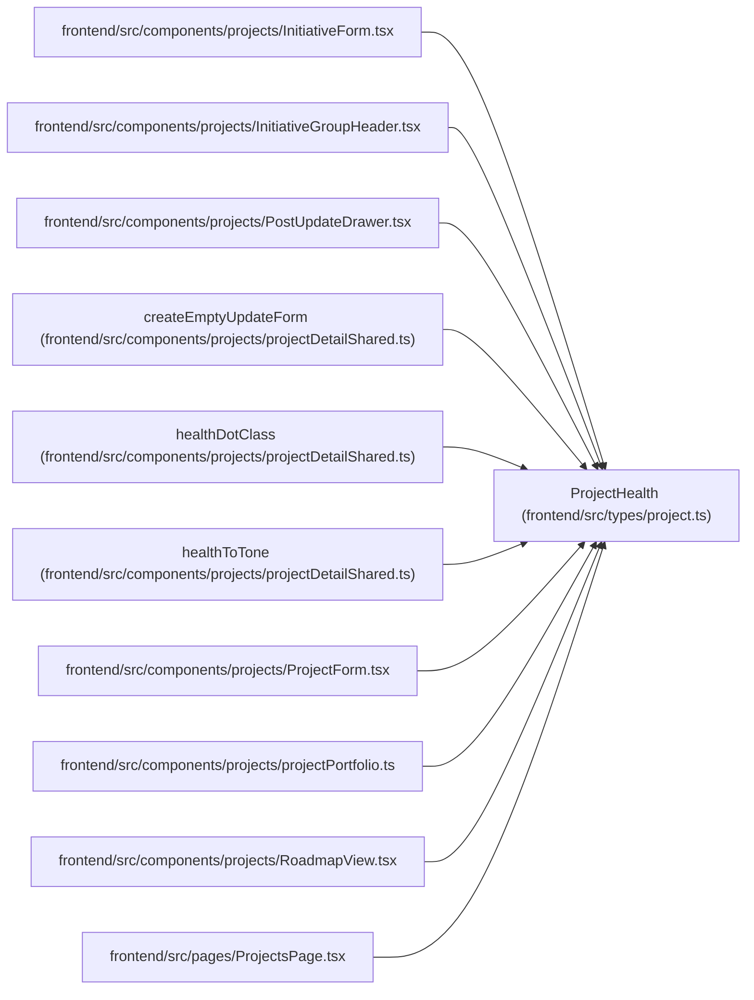

# ProjectHealth

**Location:** `frontend/src/types/project.ts:6`
**Kind:** Type alias
**Bases:** —
**Module:** [types_project](../modules/types_project.md)
**Target:**

```typescript
'unknown' | 'on_track' | 'at_risk' | 'off_track'
```

## Description

_Auto-generated from `ProjectHealth` in `frontend/src/types/project.ts`._

## Attributes

*See the alias definition for its member types.*

## Methods

*See the alias definition for callable and member types.*

## Relationships

<!-- Auto-generated relationship summary. Do not edit by hand. -->


### Summary

| Module | Methods | Attributes |
|---|---:|---|
| [types_project](../modules/types_project.md) | 0 | — |

### References

| Reference | Kind | Source | Call sites |
|---|---|---|---:|
| `InitiativeForm` | import | [InitiativeForm](../modules/InitiativeForm.md) | — |
| `InitiativeGroupHeader` | import | [InitiativeGroupHeader](../modules/InitiativeGroupHeader.md) | — |
| `PostUpdateDrawer` | import | [PostUpdateDrawer](../modules/PostUpdateDrawer.md) | — |
| `createEmptyUpdateForm` | type_reference | [projectDetailShared](../modules/projectDetailShared.md) | — |
| `healthDotClass` | type_reference | [projectDetailShared](../modules/projectDetailShared.md) | — |
| `healthToTone` | type_reference | [projectDetailShared](../modules/projectDetailShared.md) | — |
| `ProjectForm` | import | [ProjectForm](../modules/ProjectForm.md) | — |
| `projectPortfolio` | import | [projectPortfolio](../modules/projectPortfolio.md) | — |
| `RoadmapView` | import | [RoadmapView](../modules/RoadmapView.md) | — |
| `ProjectsPage` | import | [ProjectsPage](../modules/ProjectsPage.md) | — |
