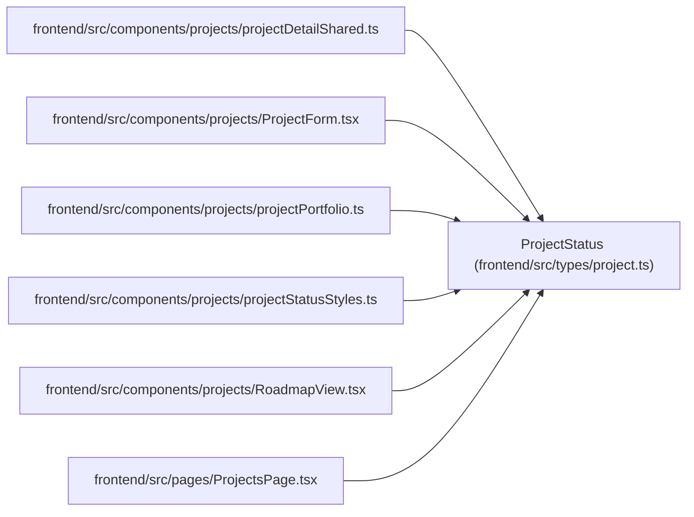

# ProjectStatus

**Location:** `frontend/src/types/project.ts:5`
**Kind:** Type alias
**Bases:** —
**Module:** [types_project](../modules/types_project.md)
**Target:**

```typescript
'proposed' | 'planned' | 'active' | 'paused' | 'completed' | 'canceled'
```

## Description

_Auto-generated from `ProjectStatus` in `frontend/src/types/project.ts`._

## Attributes

*See the alias definition for its member types.*

## Methods

*See the alias definition for callable and member types.*

## Relationships

<!-- Auto-generated relationship summary. Do not edit by hand. -->


### Summary

| Module | Methods | Attributes |
|---|---:|---|
| [types_project](../modules/types_project.md) | 0 | — |

### References

| Reference | Kind | Source | Call sites |
|---|---|---|---:|
| `projectDetailShared` | import | [projectDetailShared](../modules/projectDetailShared.md) | — |
| `ProjectForm` | import | [ProjectForm](../modules/ProjectForm.md) | — |
| `projectPortfolio` | import | [projectPortfolio](../modules/projectPortfolio.md) | — |
| `projectStatusStyles` | import | [projectStatusStyles](../modules/projectStatusStyles.md) | — |
| `RoadmapView` | import | [RoadmapView](../modules/RoadmapView.md) | — |
| `ProjectsPage` | import | [ProjectsPage](../modules/ProjectsPage.md) | — |
