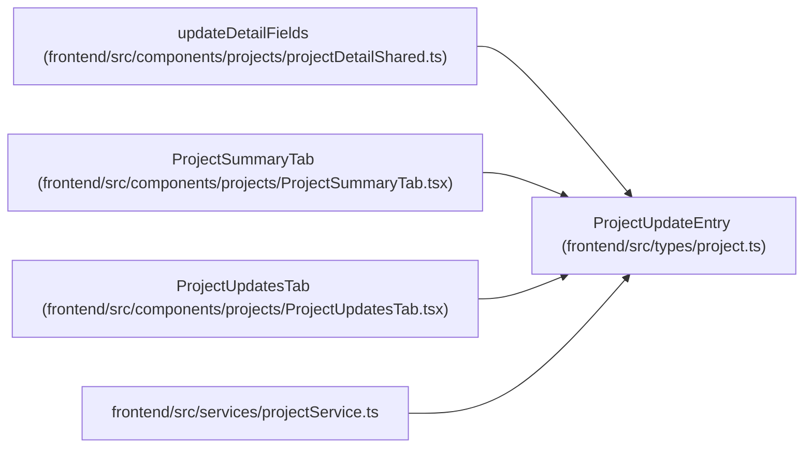

# ProjectUpdateEntry

**Location:** `frontend/src/types/project.ts:103`
**Kind:** Interface
**Bases:** —
**Module:** [types_project](../modules/types_project.md)

## Description

_Auto-generated from `ProjectUpdateEntry` in `frontend/src/types/project.ts`._

## Attributes

| Name | Type | Required | Default | Description |
|------|------|----------|---------|-------------|
| `id` | `number` | Yes | — | — |
| `project_id` | `number` | Yes | — | — |
| `health` | `ProjectHealth` | Yes | — | — |
| `summary` | `string` | Yes | — | — |
| `progress_text` | `string \| null` | No | — | — |
| `risks_text` | `string \| null` | No | — | — |
| `decisions_text` | `string \| null` | No | — | — |
| `next_steps_text` | `string \| null` | No | — | — |
| `created_by_session_id` | `number \| null` | No | — | — |
| `created_at` | `string` | Yes | — | — |

## Methods

*No declared methods.*

## Relationships

<!-- Auto-generated relationship summary. Do not edit by hand. -->

### Summary

| Module | Methods | Attributes |
|---|---:|---|
| [types_project](../modules/types_project.md) | 0 | `created_at`, `created_by_session_id`, `decisions_text`, `health`, `id`, `next_steps_text`, `progress_text`, `project_id`, `risks_text`, `summary` |

### References

| Reference | Kind | Source | Call sites |
|---|---|---|---:|
| `updateDetailFields` | type_reference | [projectDetailShared](../modules/projectDetailShared.md) | — |
| `ProjectSummaryTab` | type_reference | [ProjectSummaryTab](../modules/ProjectSummaryTab.md) | — |
| `ProjectUpdatesTab` | type_reference | [ProjectUpdatesTab](../modules/ProjectUpdatesTab.md) | — |
| `projectService` | import | [projectService](../modules/projectService.md) | — |
