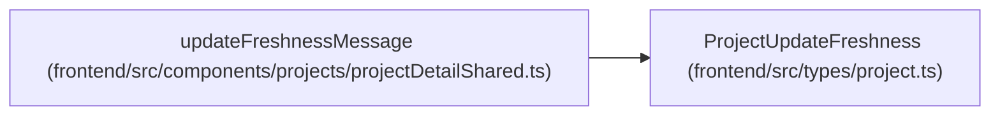

# ProjectUpdateFreshness

**Location:** `frontend/src/types/project.ts:8`
**Kind:** Type alias
**Bases:** —
**Module:** [types_project](../modules/types_project.md)
**Target:**

```typescript
'fresh' | 'stale' | 'missing' | 'not_required'
```

## Description

_Auto-generated from `ProjectUpdateFreshness` in `frontend/src/types/project.ts`._

## Attributes

*See the alias definition for its member types.*

## Methods

*See the alias definition for callable and member types.*

## Relationships

<!-- Auto-generated relationship summary. Do not edit by hand. -->


### Summary

| Module | Methods | Attributes |
|---|---:|---|
| [types_project](../modules/types_project.md) | 0 | — |

### References

| Reference | Kind | Source | Call sites |
|---|---|---|---:|
| `updateFreshnessMessage` | type_reference | [projectDetailShared](../modules/projectDetailShared.md) | — |
