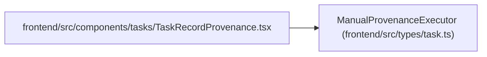

# ManualProvenanceExecutor

**Location:** `frontend/src/types/task.ts:519`
**Kind:** Interface
**Bases:** —
**Module:** [types_task](../modules/types_task.md)

## Description

The executor of work that was delivered outside recorded runs.

## Attributes

| Name | Type | Required | Default | Description |
|------|------|----------|---------|-------------|
| `kind` | `'human' \| 'agent'` | Yes | — | — |
| `principal_id` | `number` | No | — | — |
| `actor_id` | `number` | No | — | — |
| `model_binding_id` | `number` | No | — | — |

## Methods

*No declared methods.*

## Relationships

<!-- Auto-generated relationship summary. Do not edit by hand. -->

### Summary

| Module | Methods | Attributes |
|---|---:|---|
| [types_task](../modules/types_task.md) | 0 | `actor_id`, `kind`, `model_binding_id`, `principal_id` |

### References

| Reference | Kind | Source | Call sites |
|---|---|---|---:|
| `TaskRecordProvenance` | import | [TaskRecordProvenance](../modules/TaskRecordProvenance.md) | — |
