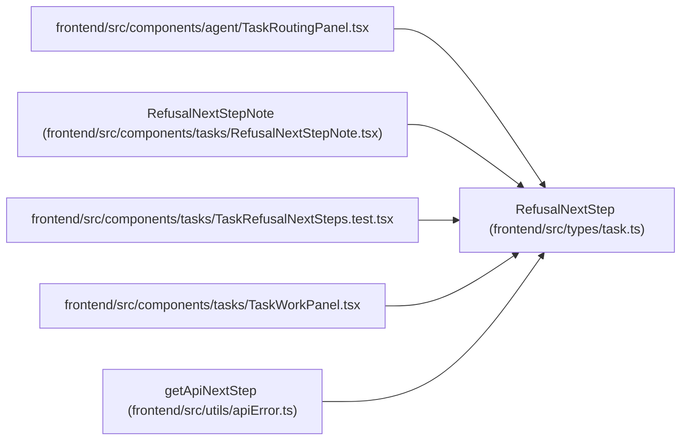

# RefusalNextStep

**Location:** `frontend/src/types/task.ts:574`
**Kind:** Interface
**Bases:** —
**Module:** [types_task](../modules/types_task.md)

## Description

What a person or agent may do about a refusal, from the server's one refusal catalogue.

## Attributes

| Name | Type | Required | Default | Description |
|------|------|----------|---------|-------------|
| `kind` | `string` | Yes | — | — |
| `authority` | `string` | Yes | — | — |
| `message` | `string` | Yes | — | — |
| `commands` | `Record<string, string>` | Yes | — | — |
| `ui_action` | `'record_provenance' \| 'accept_as_owner' \| null` | Yes | — | — |

## Methods

*No declared methods.*

## Relationships

<!-- Auto-generated relationship summary. Do not edit by hand. -->

### Summary

| Module | Methods | Attributes |
|---|---:|---|
| [types_task](../modules/types_task.md) | 0 | `authority`, `commands`, `kind`, `message`, `ui_action` |

### References

| Reference | Kind | Source | Call sites |
|---|---|---|---:|
| `TaskRoutingPanel` | import | [TaskRoutingPanel](../modules/TaskRoutingPanel.md) | — |
| `RefusalNextStepNote` | type_reference | [RefusalNextStepNote](../modules/RefusalNextStepNote.md) | — |
| `TaskRefusalNextSteps.test` | import | [TaskRefusalNextSteps.test](../modules/TaskRefusalNextSteps.test.md) | — |
| `TaskWorkPanel` | import | [TaskWorkPanel](../modules/TaskWorkPanel.md) | — |
| `getApiNextStep` | type_reference | [apiError](../modules/apiError.md) | — |
