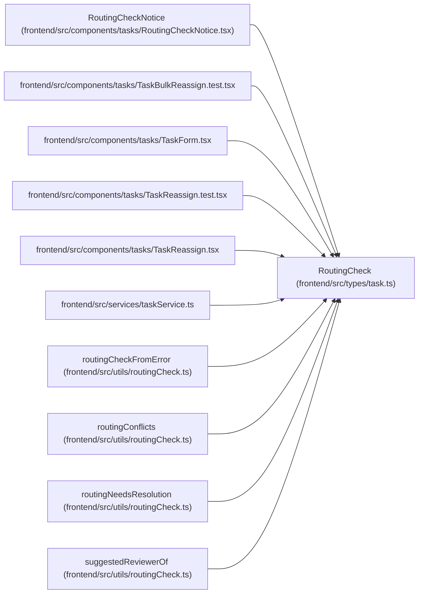

# RoutingCheck

**Location:** `frontend/src/types/task.ts:506`
**Kind:** Interface
**Bases:** —
**Module:** [types_task](../modules/types_task.md)

## Description

Whether a task's routing fits an assignee and the project's review policy, with a consistent replacement.

## Attributes

| Name | Type | Required | Default | Description |
|------|------|----------|---------|-------------|
| `task_id` | `number \| null` | No | — | — |
| `assignee_id` | `number \| null` | No | — | — |
| `assignee_profile_id` | `number \| null` | No | — | — |
| `assignee_publishers` | `string[]` | Yes | — | — |
| `assignee_catalog_keys` | `string[]` | Yes | — | — |
| `different_publisher_required` | `boolean` | Yes | — | — |
| `conflict_mode` | `TaskRoutingConflictMode` | Yes | — | — |
| `structured` | `boolean` | Yes | — | — |
| `text_routing` | `boolean` | Yes | — | — |
| `consistent` | `boolean` | Yes | — | — |
| `issues` | `RoutingIssue[]` | Yes | — | — |
| `routing` | `TaskRouting \| null` | No | — | — |
| `suggestion` | `TaskRouting \| null` | No | — | — |
| `suggested_reviewer` | `RoutingReviewer \| null` | No | — | — |
| `applied` | `boolean` | Yes | — | — |

## Methods

*No declared methods.*

## Relationships

<!-- Auto-generated relationship summary. Do not edit by hand. -->

### Summary

| Module | Methods | Attributes |
|---|---:|---|
| [types_task](../modules/types_task.md) | 0 | `applied`, `assignee_catalog_keys`, `assignee_id`, `assignee_profile_id`, `assignee_publishers`, `conflict_mode`, `consistent`, `different_publisher_required`, `issues`, `routing`, `structured`, `suggested_reviewer` |

### References

| Reference | Kind | Source | Call sites |
|---|---|---|---:|
| `RoutingCheckNotice` | type_reference | [RoutingCheckNotice](../modules/RoutingCheckNotice.md) | — |
| `TaskBulkReassign.test` | import | [TaskBulkReassign.test](../modules/TaskBulkReassign.test.md) | — |
| `TaskForm` | import | [TaskForm](../modules/TaskForm.md) | — |
| `TaskReassign.test` | import | [TaskReassign.test](../modules/TaskReassign.test.md) | — |
| `TaskReassign` | import | [TaskReassign](../modules/TaskReassign.md) | — |
| `taskService` | import | [taskService](../modules/taskService.md) | — |
| `routingCheckFromError` | type_reference | [routingCheck](../modules/routingCheck.md) | — |
| `routingConflicts` | type_reference | [routingCheck](../modules/routingCheck.md) | — |
| `routingNeedsResolution` | type_reference | [routingCheck](../modules/routingCheck.md) | — |
| `suggestedReviewerOf` | type_reference | [routingCheck](../modules/routingCheck.md) | — |
