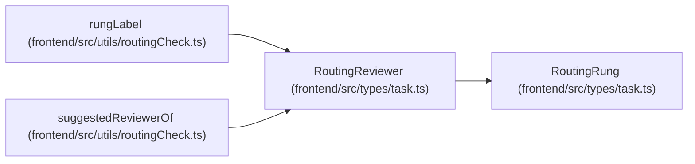

# RoutingReviewer

**Location:** `frontend/src/types/task.ts:478`
**Kind:** Interface
**Bases:** `RoutingRung`
**Module:** [types_task](../modules/types_task.md)

## Description

_Auto-generated from `RoutingReviewer` in `frontend/src/types/task.ts`._

## Attributes

| Name | Type | Required | Default | Description |
|------|------|----------|---------|-------------|
| `profile_id` | `number \| null` | No | — | — |
| `instructions` | `string` | No | — | — |

## Methods

*No declared methods.*

## Relationships

<!-- Auto-generated relationship summary. Do not edit by hand. -->

### Summary

| Module | Methods | Attributes |
|---|---:|---|
| [types_task](../modules/types_task.md) | 0 | `instructions`, `profile_id` |

### Structure

| Kind | Entity | Module |
|---|---|---|
| Base | `RoutingRung` | [types_task](../modules/types_task.md) |

### References

| Reference | Kind | Source | Call sites |
|---|---|---|---:|
| `rungLabel` | type_reference | [routingCheck](../modules/routingCheck.md) | — |
| `suggestedReviewerOf` | type_reference | [routingCheck](../modules/routingCheck.md) | — |
