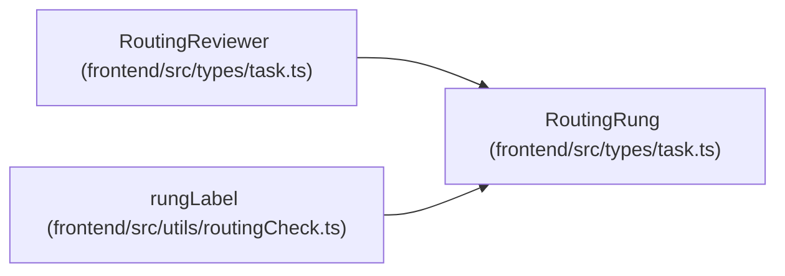

# RoutingRung

**Location:** `frontend/src/types/task.ts:470`
**Kind:** Interface
**Bases:** —
**Module:** [types_task](../modules/types_task.md)

## Description

One model catalog entry that may execute a task or review its result.

## Attributes

| Name | Type | Required | Default | Description |
|------|------|----------|---------|-------------|
| `catalog_key` | `string` | Yes | — | — |
| `harness` | `string` | No | — | — |
| `effort` | `string \| null` | No | — | — |
| `publisher_key` | `string \| null` | No | — | — |
| `configured_model_alias` | `string \| null` | No | — | — |

## Methods

*No declared methods.*

## Relationships

<!-- Auto-generated relationship summary. Do not edit by hand. -->

### Summary

| Module | Methods | Attributes |
|---|---:|---|
| [types_task](../modules/types_task.md) | 0 | `catalog_key`, `configured_model_alias`, `effort`, `harness`, `publisher_key` |

### Structure

| Kind | Entity | Module |
|---|---|---|
| Subclass | `RoutingReviewer` | [types_task](../modules/types_task.md) |

### References

| Reference | Kind | Source | Call sites |
|---|---|---|---:|
| `rungLabel` | type_reference | [routingCheck](../modules/routingCheck.md) | — |
