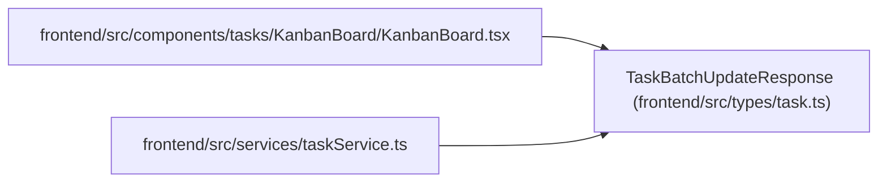

# TaskBatchUpdateResponse

**Location:** `frontend/src/types/task.ts:425`
**Kind:** Interface
**Bases:** —
**Module:** [types_task](../modules/types_task.md)

## Description

_Auto-generated from `TaskBatchUpdateResponse` in `frontend/src/types/task.ts`._

## Attributes

| Name | Type | Required | Default | Description |
|------|------|----------|---------|-------------|
| `results` | `TaskBatchUpdateResponseItem[]` | Yes | — | — |
| `updated_tasks` | `Task[]` | Yes | — | — |

## Methods

*No declared methods.*

## Relationships

<!-- Auto-generated relationship summary. Do not edit by hand. -->

### Summary

| Module | Methods | Attributes |
|---|---:|---|
| [types_task](../modules/types_task.md) | 0 | `results`, `updated_tasks` |

### References

| Reference | Kind | Source | Call sites |
|---|---|---|---:|
| `KanbanBoard` | import | [KanbanBoard](../modules/KanbanBoard.md) | — |
| `taskService` | import | [taskService](../modules/taskService.md) | — |
