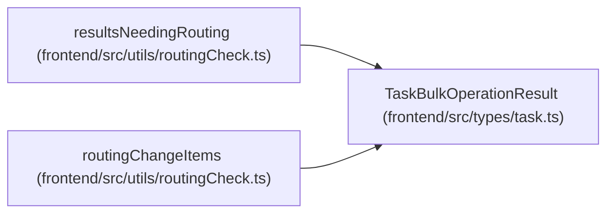

# TaskBulkOperationResult

**Location:** `frontend/src/types/task.ts:354`
**Kind:** Interface
**Bases:** —
**Module:** [types_task](../modules/types_task.md)

## Description

_Auto-generated from `TaskBulkOperationResult` in `frontend/src/types/task.ts`._

## Attributes

| Name | Type | Required | Default | Description |
|------|------|----------|---------|-------------|
| `task_id` | `number` | Yes | — | — |
| `outcome` | `TaskBulkOutcome` | Yes | — | — |
| `changes` | `Record<string, { old: unknown; new: unknown } \| unknown>` | Yes | — | — |
| `warnings` | `string[]` | Yes | — | — |
| `error` | `string \| null` | No | — | — |
| `task` | `Task \| null` | No | — | — |
| `assignee_recommendation` | `AssigneeRecommendation \| null` | No | — | — |
| `routing_check` | `RoutingCheck \| null` | No | — | — |

## Methods

*No declared methods.*

## Relationships

<!-- Auto-generated relationship summary. Do not edit by hand. -->

### Summary

| Module | Methods | Attributes |
|---|---:|---|
| [types_task](../modules/types_task.md) | 0 | `assignee_recommendation`, `changes`, `error`, `outcome`, `routing_check`, `task`, `task_id`, `warnings` |

### References

| Reference | Kind | Source | Call sites |
|---|---|---|---:|
| `resultsNeedingRouting` | type_reference | [routingCheck](../modules/routingCheck.md) | — |
| `routingChangeItems` | type_reference | [routingCheck](../modules/routingCheck.md) | — |
