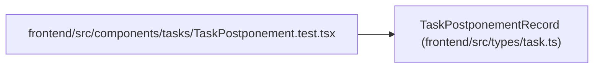

# TaskPostponementRecord

**Location:** `frontend/src/types/task.ts:499`
**Kind:** Interface
**Bases:** —
**Module:** [types_task](../modules/types_task.md)

## Description

_Auto-generated from `TaskPostponementRecord` in `frontend/src/types/task.ts`._

## Attributes

| Name | Type | Required | Default | Description |
|------|------|----------|---------|-------------|
| `id` | `number` | Yes | — | — |
| `task_id` | `number` | Yes | — | — |
| `open` | `boolean` | Yes | — | — |
| `from_status` | `'planned' \| 'active' \| 'resolved'` | Yes | — | — |
| `reason` | `string` | Yes | — | — |
| `postponed_at` | `string` | Yes | — | — |
| `released` | `{ claim_actor_id: number \| null; claim_generation: number \| null; assignment_ids: number[]; run_ids: number[] }` | Yes | — | — |
| `requirements` | `ReactivationRequirement[]` | Yes | — | — |
| `reactivated_at` | `string \| null` | Yes | — | — |
| `reactivated_to_status` | `'planned' \| 'resolved' \| null` | Yes | — | — |
| `reactivation_reason` | `string \| null` | Yes | — | — |

## Methods

*No declared methods.*

## Relationships

<!-- Auto-generated relationship summary. Do not edit by hand. -->

### Summary

| Module | Methods | Attributes |
|---|---:|---|
| [types_task](../modules/types_task.md) | 0 | `from_status`, `id`, `open`, `postponed_at`, `reactivated_at`, `reactivated_to_status`, `reactivation_reason`, `reason`, `released`, `requirements`, `task_id` |

### References

| Reference | Kind | Source | Call sites |
|---|---|---|---:|
| `TaskPostponement.test` | import | [TaskPostponement.test](../modules/TaskPostponement.test.md) | — |
