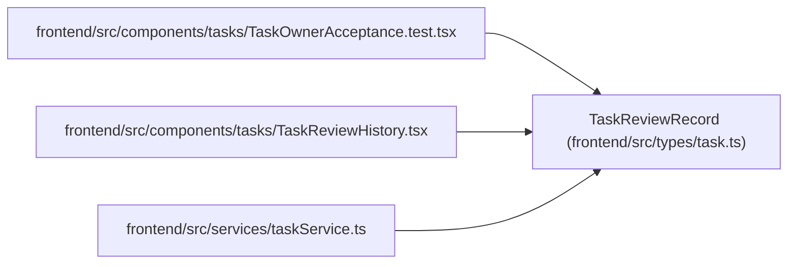

# TaskReviewRecord

**Location:** `frontend/src/types/task.ts:480`
**Kind:** Interface
**Bases:** —
**Module:** [types_task](../modules/types_task.md)

## Description

One recorded review. `owner_override` is an owner's acceptance that set aside publisher independence.

## Attributes

| Name | Type | Required | Default | Description |
|------|------|----------|---------|-------------|
| `id` | `number` | Yes | — | — |
| `task_version` | `number` | Yes | — | — |
| `brief_revision` | `number` | Yes | — | — |
| `artifact_revision` | `number` | Yes | — | — |
| `principal_id` | `number \| null` | Yes | — | — |
| `verdict` | `'accept' \| 'reject' \| string` | Yes | — | — |
| `kind` | `'review' \| 'owner_override'` | Yes | — | — |
| `reason` | `string` | Yes | — | — |
| `evidence` | `string` | Yes | — | — |
| `created_at` | `string` | Yes | — | — |

## Methods

*No declared methods.*

## Relationships

<!-- Auto-generated relationship summary. Do not edit by hand. -->

### Summary

| Module | Methods | Attributes |
|---|---:|---|
| [types_task](../modules/types_task.md) | 0 | `artifact_revision`, `brief_revision`, `created_at`, `evidence`, `id`, `kind`, `principal_id`, `reason`, `task_version`, `verdict` |

### References

| Reference | Kind | Source | Call sites |
|---|---|---|---:|
| `TaskOwnerAcceptance.test` | import | [TaskOwnerAcceptance.test](../modules/TaskOwnerAcceptance.test.md) | — |
| `TaskReviewHistory` | import | [TaskReviewHistory](../modules/TaskReviewHistory.md) | — |
| `taskService` | import | [taskService](../modules/taskService.md) | — |
