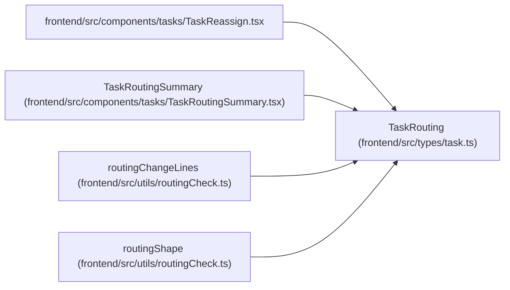

# TaskRouting

**Location:** `frontend/src/types/task.ts:483`
**Kind:** Interface
**Bases:** —
**Module:** [types_task](../modules/types_task.md)

## Description

_Auto-generated from `TaskRouting` in `frontend/src/types/task.ts`._

## Attributes

| Name | Type | Required | Default | Description |
|------|------|----------|---------|-------------|
| `schema_version` | `1` | Yes | — | — |
| `first_rung` | `RoutingRung \| null` | No | — | — |
| `escalation` | `RoutingRung[]` | Yes | — | — |
| `escalate_after_failed_runs` | `number` | Yes | — | — |
| `after_last_rung` | `string` | No | — | — |
| `reviewer` | `RoutingReviewer \| null` | No | — | — |
| `notes` | `string` | No | — | — |

## Methods

*No declared methods.*

## Relationships

<!-- Auto-generated relationship summary. Do not edit by hand. -->

### Summary

| Module | Methods | Attributes |
|---|---:|---|
| [types_task](../modules/types_task.md) | 0 | `after_last_rung`, `escalate_after_failed_runs`, `escalation`, `first_rung`, `notes`, `reviewer`, `schema_version` |

### References

| Reference | Kind | Source | Call sites |
|---|---|---|---:|
| `TaskReassign` | import | [TaskReassign](../modules/TaskReassign.md) | — |
| `TaskRoutingSummary` | type_reference | [TaskRoutingSummary](../modules/TaskRoutingSummary.md) | — |
| `routingChangeLines` | type_reference | [routingCheck](../modules/routingCheck.md) | — |
| `routingShape` | type_reference | [routingCheck](../modules/routingCheck.md) | — |
