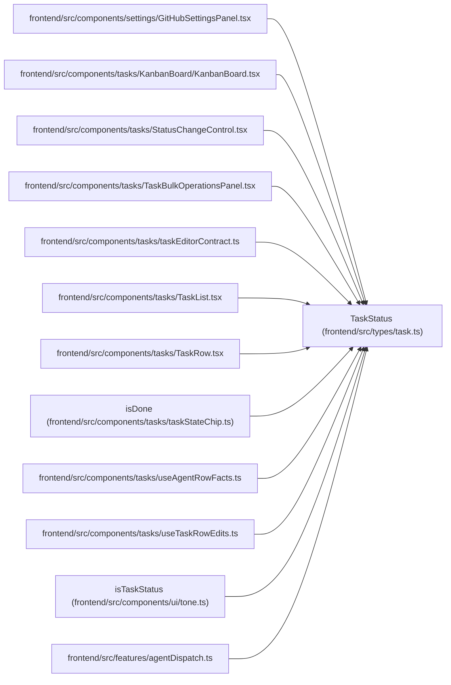

# TaskStatus

**Location:** `frontend/src/types/task.ts:51`
**Kind:** Type alias
**Bases:** —
**Module:** [types_task](../modules/types_task.md)
**Target:**

```typescript
'planned' | 'active' | 'resolved' | 'postponed' | 'closed'
```

## Description

_Auto-generated from `TaskStatus` in `frontend/src/types/task.ts`._

## Attributes

*See the alias definition for its member types.*

## Methods

*See the alias definition for callable and member types.*

## Relationships

<!-- Auto-generated relationship summary. Do not edit by hand. -->


### Summary

| Module | Methods | Attributes |
|---|---:|---|
| [types_task](../modules/types_task.md) | 0 | — |

### References

| Reference | Kind | Source | Call sites |
|---|---|---|---:|
| `GitHubSettingsPanel` | import | [GitHubSettingsPanel](../modules/GitHubSettingsPanel.md) | — |
| `KanbanBoard` | import | [KanbanBoard](../modules/KanbanBoard.md) | — |
| `StatusChangeControl` | import | [StatusChangeControl](../modules/StatusChangeControl.md) | — |
| `TaskBulkOperationsPanel` | import | [TaskBulkOperationsPanel](../modules/TaskBulkOperationsPanel.md) | — |
| `taskEditorContract` | import | [taskEditorContract](../modules/taskEditorContract.md) | — |
| `TaskList` | import | [TaskList](../modules/TaskList.md) | — |
| `TaskRow` | import | [TaskRow](../modules/TaskRow.md) | — |
| `isDone` | type_reference | [taskStateChip](../modules/taskStateChip.md) | — |
| `useAgentRowFacts` | import | [useAgentRowFacts](../modules/useAgentRowFacts.md) | — |
| `useTaskRowEdits` | import | [useTaskRowEdits](../modules/useTaskRowEdits.md) | — |
| `isTaskStatus` | type_reference | [tone](../modules/tone.md) | — |
| `agentDispatch` | import | [agentDispatch](../modules/agentDispatch.md) | — |

> References: showing 12 of 20 logical references; 8 omitted by the 12-row generated summary limit.
