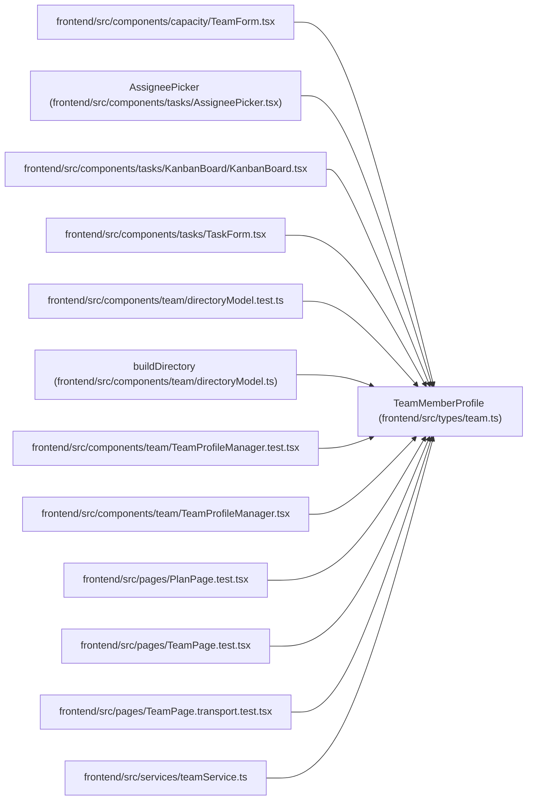

# TeamMemberProfile

**Location:** `frontend/src/types/team.ts:60`
**Kind:** Interface
**Bases:** —
**Module:** [types_team](../modules/types_team.md)

## Description

_Auto-generated from `TeamMemberProfile` in `frontend/src/types/team.ts`._

## Attributes

| Name | Type | Required | Default | Description |
|------|------|----------|---------|-------------|
| `id` | `number` | Yes | — | — |
| `seed_key` | `string \| null` | No | — | — |
| `display_name` | `string` | Yes | — | — |
| `email` | `string \| null` | No | — | — |
| `headline` | `string \| null` | No | — | — |
| `summary` | `string \| null` | No | — | — |
| `notes` | `string \| null` | No | — | — |
| `automation_enabled` | `boolean` | Yes | — | — |
| `profile_kind` | `TeamMemberProfileKind` | Yes | — | — |
| `assignment_modes` | `TeamMemberAssignmentMode[]` | Yes | — | — |
| `skills` | `TeamMemberProfileSkill[]` | Yes | — | — |
| `created_at` | `string` | Yes | — | — |
| `updated_at` | `string` | Yes | — | — |

## Methods

*No declared methods.*

## Relationships

<!-- Auto-generated relationship summary. Do not edit by hand. -->

### Summary

| Module | Methods | Attributes |
|---|---:|---|
| [types_team](../modules/types_team.md) | 0 | `assignment_modes`, `automation_enabled`, `created_at`, `display_name`, `email`, `headline`, `id`, `notes`, `profile_kind`, `seed_key`, `skills`, `summary` |

### References

| Reference | Kind | Source | Call sites |
|---|---|---|---:|
| `TeamForm` | import | [TeamForm](../modules/TeamForm.md) | — |
| `AssigneePicker` | type_reference | [AssigneePicker](../modules/AssigneePicker.md) | — |
| `KanbanBoard` | import | [KanbanBoard](../modules/KanbanBoard.md) | — |
| `TaskForm` | import | [TaskForm](../modules/TaskForm.md) | — |
| `directoryModel.test` | import | [directoryModel.test](../modules/directoryModel.test.md) | — |
| `buildDirectory` | type_reference | [directoryModel](../modules/directoryModel.md) | — |
| `TeamProfileManager.test` | import | [TeamProfileManager.test](../modules/TeamProfileManager.test.md) | — |
| `TeamProfileManager` | import | [TeamProfileManager](../modules/TeamProfileManager.md) | — |
| `PlanPage.test` | import | [PlanPage.test](../modules/PlanPage.test.md) | — |
| `TeamPage.test` | import | [TeamPage.test](../modules/TeamPage.test.md) | — |
| `TeamPage.transport.test` | import | [TeamPage.transport.test](../modules/TeamPage.transport.test.md) | — |
| `teamService` | import | [teamService](../modules/teamService.md) | — |
